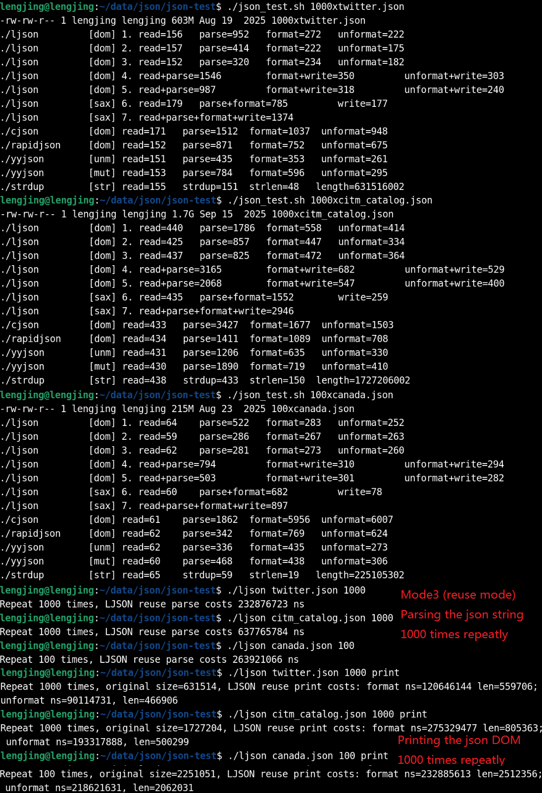
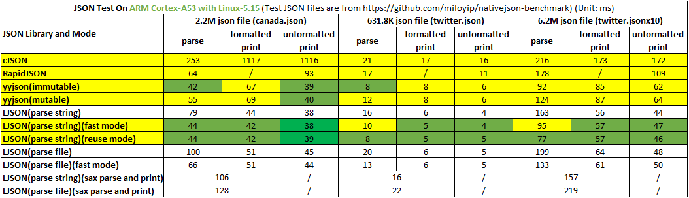
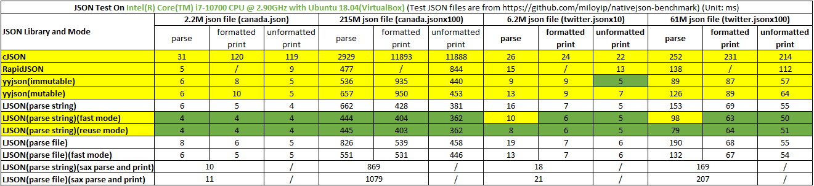
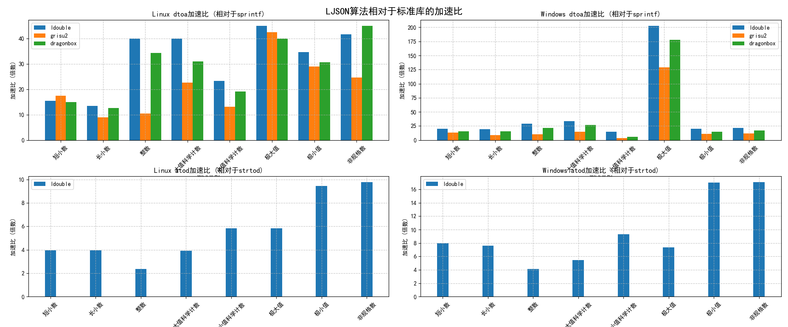

# LJSON

       

[中文版](./README_zh-cn.md)

> **LJSON in One Sentence**
>
> **LJSON is one library with two engines: a fully-featured JSON5-compliant JSON engine, and one of the fastest bidirectional number↔string conversion engines available.**
>
> It is written in **pure C99**, has **zero third-party dependencies**, and **depends on no CPU-specific features (no SIMD, no inline assembly)** — yet it lands in the fastest tier among general-purpose, editable JSON libraries. That is because its performance comes entirely from **algorithms, data structures, and engineering trade-offs**, not from squeezing a particular instruction set.

- [Why LJSON: Ten Things to Read First](#why-ljson-ten-things-to-read-first)
- [1. Project Positioning](#1-project-positioning)
  - [1.1 Dual-Mode Engine: One Library, Two Engines](#11-dual-mode-engine-one-library-two-engines)
  - [1.2 What "General-Purpose and Fastest" Means](#12-what-general-purpose-and-fastest-means)
  - [1.3 Version and Compatibility](#13-version-and-compatibility)
- [2. Key Features](#2-key-features)
  - [2.1 JSON Engine Features](#21-json-engine-features)
  - [2.2 Numeric Engine (LDOUBLE) Features](#22-numeric-engine-ldouble-features)
  - [2.3 Supported Data Types](#23-supported-data-types)
- [3. Architecture: 7 Parse Modes × 4 Print Modes](#3-architecture-7-parse-modes--4-print-modes)
  - [3.1 Seven Parse Modes](#31-seven-parse-modes)
  - [3.2 Four Print Modes](#32-four-print-modes)
  - [3.3 Mode Selection Guide](#33-mode-selection-guide)
  - [3.4 Mode Combination Matrix](#34-mode-combination-matrix)
- [4. Quick Start](#4-quick-start)
  - [4.1 Where to Find the API Documentation](#41-where-to-find-the-api-documentation)
  - [4.2 Recommended: The Zero-Heap-Allocation Mode](#42-recommended-the-zero-heap-allocation-mode)
  - [4.3 Minimal Example: Parse → Read → Print](#43-minimal-example-parse--read--print)
  - [4.4 Memory-Pool Mode and Reuse Mode](#44-memory-pool-mode-and-reuse-mode)
  - [4.5 Two Ways to Speed Up Message Parsing](#45-two-ways-to-speed-up-message-parsing)
    - [4.5.1 Basics: Make Key Strings Constant](#451-basics-make-key-strings-constant)
    - [4.5.2 Speed-Up Mode 1: Get items First, Then Access in Bulk](#452-speed-up-mode-1-get-items-first-then-access-in-bulk)
    - [4.5.3 Speed-Up Mode 2: Pre-fill prev, Continue the Search](#453-speed-up-mode-2-pre-fill-prev-continue-the-search)
    - [4.5.4 How to Choose Between the Two Modes](#454-how-to-choose-between-the-two-modes)
  - [4.6 Editing: Add / Modify / Delete](#46-editing-add--modify--delete)
  - [4.7 SAX Parsing: Callback Driven](#47-sax-parsing-callback-driven)
  - [4.8 SAX Printing: Output Directly Without a DOM](#48-sax-printing-output-directly-without-a-dom)
  - [4.9 Streaming File Parsing and Printing](#49-streaming-file-parsing-and-printing)
  - [4.10 Using the Numeric Engine Standalone](#410-using-the-numeric-engine-standalone)
  - [4.11 The Binary Extension Type](#411-the-binary-extension-type)
- [5. Building and Running](#5-building-and-running)
  - [5.1 How to Build and Install](#51-how-to-build-and-install)
  - [5.2 Compile-Time Switches](#52-compile-time-switches)
  - [5.3 How to Run](#53-how-to-run)
  - [5.4 Debugging](#54-debugging)
  - [5.5 Parse Configuration](#55-parse-configuration)
- [6. Performance Benchmarks](#6-performance-benchmarks)
  - [6.1 Test Notes and Environment](#61-test-notes-and-environment)
  - [6.2 Intel i7-1260P (v5.0.5, latest) ★](#62-intel-i7-1260p-v505-latest-)
  - [6.3 Latest Terminal Measurements: All 7 Modes Compared](#63-latest-terminal-measurements-all-7-modes-compared)
  - [6.4 Reuse Mode: Repeated Parse / Print Throughput](#64-reuse-mode-repeated-parse--print-throughput)
  - [6.5 ARM Cortex-A53 (historical data, v3 era)](#65-arm-cortex-a53-historical-data-v3-era)
  - [6.6 Intel i7-10700 (historical data, v3 era)](#66-intel-i7-10700-historical-data-v3-era)
  - [6.7 Numeric Conversion Performance](#67-numeric-conversion-performance)
- [7. Why LJSON Is So Fast: A Code-Level Deep Dive](#7-why-ljson-is-so-fast-a-code-level-deep-dive)
  - [7.1 Methodology: Measure → Analyze → Optimize → Verify](#71-methodology-measure--analyze--optimize--verify)
  - [7.2 The Optimization Hierarchy: Where the Gains Come From](#72-the-optimization-hierarchy-where-the-gains-come-from)
  - [7.3 Amdahl's Law: Why Pick the Right Path First](#73-amdahls-law-why-pick-the-right-path-first)
  - [7.4 Algorithms and Frameworks: Choosing the Right Path](#74-algorithms-and-frameworks-choosing-the-right-path)
  - [7.5 Hot/Cold Splitting: Move Rarely-Run Code Out of the Hot Path](#75-hotcold-splitting-move-rarely-run-code-out-of-the-hot-path)
    - [7.5.1 Two Ways to Write It](#751-two-ways-to-write-it)
    - [7.5.2 Three Examples in LJSON](#752-three-examples-in-ljson)
    - [7.5.3 How to Choose](#753-how-to-choose)
    - [7.5.4 Extension: One-Shot Dispatch Between Implementations](#754-extension-one-shot-dispatch-between-implementations)
  - [7.6 Two-Stage String Parsing: Fast Path First, Full Path as Fallback](#76-two-stage-string-parsing-fast-path-first-full-path-as-fallback)
  - [7.7 Print Hot Path: Local `cur` + `_XXX_SYNC` Macros + 64 Extra Bytes](#77-print-hot-path-local-cur--_xxx_sync-macros--64-extra-bytes)
  - [7.8 Data Structures: The 32-Byte json_object](#78-data-structures-the-32-byte-json_object)
  - [7.9 Linked List Design: A Singly Circular List with O(1) Append](#79-linked-list-design-a-singly-circular-list-with-o1-append)
  - [7.10 Memory Pool: A Bump Allocator That Settles Allocation in Two Comparisons](#710-memory-pool-a-bump-allocator-that-settles-allocation-in-two-comparisons)
  - [7.11 Zero Copy: Reusing the Original String In Place](#711-zero-copy-reusing-the-original-string-in-place)
  - [7.12 Recording Information: Caching strlen and Escape Scans](#712-recording-information-caching-strlen-and-escape-scans)
  - [7.13 Faster Access: json_items and Hash Binary Search](#713-faster-access-json_items-and-hash-binary-search)
  - [7.14 Trading Space for Time: Lookup Tables](#714-trading-space-for-time-lookup-tables)
  - [7.15 Fast Integer Division: Turn Division into Multiplication](#715-fast-integer-division-turn-division-into-multiplication)
    - [7.15.1 How It Works](#7151-how-it-works)
    - [7.15.2 Python Implementation](#7152-python-implementation)
    - [7.15.3 Common Fast Division Tables](#7153-common-fast-division-tables)
  - [7.16 Bulk Operations: Move 4/8/16 Bytes at a Time](#716-bulk-operations-move-4816-bytes-at-a-time)
  - [7.17 Branch Prediction and Manual Loop Unrolling](#717-branch-prediction-and-manual-loop-unrolling)
  - [7.18 True Streaming: Folding I/O into the Parse/Print Pipeline](#718-true-streaming-folding-io-into-the-parseprint-pipeline)
  - [7.19 Print Buffer: Geometric Growth + External Reuse](#719-print-buffer-geometric-growth--external-reuse)
  - [7.20 Compile-Time Configuration: Turn Runtime Switches into Nonexistent Code](#720-compile-time-configuration-turn-runtime-switches-into-nonexistent-code)
  - [7.21 Trading Precision for Speed: The ldouble Compromise](#721-trading-precision-for-speed-the-ldouble-compromise)
  - [7.22 The Complete Optimization Checklist](#722-the-complete-optimization-checklist)
- [8. Head-to-Head: LJSON vs yyjson / RapidJSON / cJSON](#8-head-to-head-ljson-vs-yyjson--rapidjson--cjson)
  - [8.1 At a Glance](#81-at-a-glance)
  - [8.2 vs cJSON](#82-vs-cjson)
  - [8.3 vs RapidJSON](#83-vs-rapidjson)
  - [8.4 vs yyjson](#84-vs-yyjson)
  - [8.5 Decision Tree: Which One Should I Pick?](#85-decision-tree-which-one-should-i-pick)
- [9. FAQ](#9-faq)
- [10. References and License](#10-references-and-license)

## Why LJSON: Ten Things to Read First

If you only have 30 seconds to decide whether to keep reading, this table is enough. By "general-purpose library" we mean: **it can both parse and print, it is editable and reusable, and it handles everything from tiny messages to multi-GB files** — as opposed to a specialized library that pushes a single metric to the extreme and nothing else.

> This chapter is a **quick overview**: one line per item, covering "what it is" and "what it does for you".
> The technical details and measurements behind each item are expanded in [Chapter 2: Key Features](#2-key-features), [Chapter 6: Performance Benchmarks](#6-performance-benchmarks), and [Chapter 7: Why LJSON Is So Fast](#7-why-ljson-is-so-fast-a-code-level-deep-dive).

| # | Selling point | What LJSON does | What it means for you |
|:--:|------|------|------|
| 1 | **Pure C99, zero dependencies** | Only standard headers such as `<string.h>` / `<stdlib.h>` / `<stdio.h>`; two files `jnum.c` and `json.c` are enough to build | Works on embedded, RTOS, bare metal, cross-compilation; builds very fast |
| 2 | **No CPU-feature dependency** | No SIMD, no inline assembly; every compiler intrinsic used (`__builtin_clzll`, `_umul128`, `__int128`) has a portable C fallback | Change architecture without changing code; consistent on ARM/x86/RISC-V/MIPS |
| 3 | **Unified C11 generic interface** | `json_create_unit` / `json_create_units` / `json_set_number` / `json_sax_print_array_item` dispatch by type via `_Generic`; automatically switches to overloads under C++ | One API for `bool/int32/uint32/int64/uint64/double/string/binary` — feels like a dynamic language |
| 4 | **7 parse modes** | Classic DOM / memory-pool DOM / reuse DOM / file-stream DOM / file-stream + memory-pool DOM / SAX / SAX file-stream | Small messages, large files, read-only scanning, editable trees — each has an optimal answer, no compromise for all |
| 5 | **4 print modes** | DOM→string, DOM→file (true streaming), SAX→string, SAX→file (true streaming) | Printing a huge JSON never requires materializing the whole string first; memory can stay constant |
| 6 | **True streaming** | Parses while reading, writes while printing — not the fake "read it all, then parse / print it all, then write" | A 1 GB JSON can be reformatted with KB-level memory |
| 7 | **Editable *and* zero-copy** | Reuse mode (mode 3) reuses the original string in place **and stays natively editable** (yyjson needs an extra conversion, doubling memory) | For "fast but also mutable" workloads, LJSON is one of the few viable answers |
| 8 | **Zero heap allocation** | After the first allocation, the library performs **no heap allocation at all** during the parse/print loop | High-frequency message handling with no fragmentation, no allocation jitter, predictable latency |
| 9 | **In-house ldouble numeric engine** | float→string costs only **1.5%~10%** of `sprintf` (10~70× faster); string→number is 1~10× faster than `strtod` | Float-heavy JSON (geospatial, time series) gains an order of magnitude in print performance |
| 10 | **Engineering maintainability** | About 10k lines, clear structure, **bilingual (Chinese/English) comments** on every API; API style modeled on cJSON | Readable, modifiable, extensible — not a black box you can only admire |

In one sentence: **LJSON is not "the library that is fastest in one particular mode" — it is "the library that lets you pick a near-optimal path for any scenario, while still being faster than most libraries on that path."**

---

## 1. Project Positioning

### 1.1 Dual-Mode Engine: One Library, Two Engines

LJSON ships two engines in one repository. They can be used independently or work together deeply:

| Engine | Source | Header | Responsibility | Usable standalone |
|------|------|--------|------|:------------:|
| **JSON engine** | `json.c` | `json.h` | Parsing and generating JSON5 text: DOM / SAX dual paradigm, true streaming file I/O, memory pool, in-place reuse, zero-heap allocation, `json_items` access acceleration, `prev` access acceleration | ✅ |
| **Numeric engine (jnum)** | `jnum.c` | `jnum.h` | Bidirectional high-speed number↔string conversion: integers / long integers / hex / double, with the in-house **ldouble** algorithm | ✅ just compile `jnum.c` |

**How the two work together**: every number printed as JSON goes through a "number → string" conversion. LJSON does not call `sprintf`; the print path calls its own `jnum_dtoa` directly. That single decision is the direct reason print performance on float-heavy data (such as `canada.json`) beats cJSON by an order of magnitude.

### 1.2 What "General-Purpose and Fastest" Means

LJSON is positioned as a **general-purpose JSON library**, not a benchmark-specialized one. Its objective function balances five variables at once:

```
performance  +  memory footprint  +  editability  +  streaming  +  maintainability
```

This explains how it differs from the "extremist" libraries:

* **Extremists** (e.g. yyjson's read-only mode): push one point to the extreme, at the cost of **giving up streaming, giving up in-place editability, giving up standard C strings, giving up code readability**.
* **LJSON**: provides a complete mode matrix so every scenario can match a near-optimal path, while **still winning on the general-purpose editable path**.

Its architectural philosophy in one sentence:

> **There is no absolutely optimal mode, only the most suitable mode.**
> Rather than compromise by forcing every scenario into a single implementation, hand the choice to the user — but make sure every choice is still fast.

### 1.3 Version and Compatibility

* Current version: **v5.x**
* Born: **October 2019**
* **Important compatibility note**: on 64-bit systems, starting from **v5.0.0**, the JSON object was shrunk from **40 bytes** to **32 bytes**, improving parse speed by **5%~10%**, and is **not compatible with v3.x.x**. When upgrading from v3 to v5, update your calling code accordingly.

---

## 2. Key Features

### 2.1 JSON Engine Features

**① Extremely fast parsing and printing**

On three samples — `1000×twitter.json` (603 MB), `1000×citm_catalog.json` (1.7 GB), and `100×canada.json` (215 MB) — LJSON's reuse mode (mode 3, editable) leads cJSON / RapidJSON / yyjson across the board: **1.2~6.6× faster parsing, 1.1~23× faster printing**. Full data and analysis are in [Section 6.3: Latest Terminal Measurements](#63-latest-terminal-measurements-all-7-modes-compared) and [Chapter 8: Head-to-Head](#8-head-to-head-ljson-vs-yyjson--rapidjson--cjson).

**② Full JSON5 support (off by default for speed, enable on demand)**

Supports hex numbers, comments, trailing commas, single-quoted/unquoted keys, special characters inside strings, `NaN`/`Infinity`, and other modern JSON features.

> ⚠️ **Important**: some JSON5 features significantly affect the parse hot path, so they are **off by default** (speed first). Set the corresponding macro to 1 in `json.c` and rebuild when you need them; see [Section 5.5: Parse Configuration](#55-parse-configuration).
> Among them, `JSON_PARSE_SKIP_COMMENT` (comments) and `JSON_PARSE_SPECIAL_QUOTES` (single-quoted/unquoted keys) are **off by default and have the largest impact on speed**.

**③ True streaming file handling**

* Parsing: **parses while reading the file**, not "read everything first"
* Printing: **writes to the file while printing**, not "print everything first"
* SAX + file streaming keeps memory at a **constant level**: even a 1 GB JSON file can be reformatted with KB-level memory

**④ Multi-level memory management**

| Level | Approach | Benefit |
|------|------|------|
| Classic allocation | `malloc` / `free` per node | General-purpose, individually freeable |
| Memory pool | Big-block bump allocation | No fragmentation, near-zero allocation cost |
| In-place string reuse | Use the original buffer directly as the storage for keys and strings | Zero copy; saves one memcpy and one malloc |
| Zero-heap-allocation loop | Keep reusing after the first allocation | Zero `malloc` inside the library during the loop; predictable latency |

**⑤ Memory reuse (two meanings)**

1. **The original data is directly used as the storage for keys and strings** (in-place reuse)
2. **The same block of memory is reused across many parses and prints**, so the library never needs to allocate on the heap

**⑥ Extended data types**

Besides standard JSON types: long integers (64-bit), hex numbers, and the **binary data extension (format `<len:data>`)**.

**⑦ Compact object**

On 64-bit systems `json_object` was shrunk from 40 bytes to **32 bytes** (since v5.0.0), improving parse speed by 5%~10%. See [Section 7.8: Data Structures](#78-data-structures-the-32-byte-json_object).

**⑧ Developer friendly**

* API designed with reference to [cJSON](https://github.com/DaveGamble/cJSON), so migration cost is very low
* Pure C, no third-party library dependencies
* Supports gcc / clang / MSVC and other compilers; x86 / ARM / RISC-V and other architectures
* Every API carries **bilingual (Chinese/English) comments**
* C11 `_Generic` generic interfaces + C++ overloads: one API for all types

### 2.2 Numeric Engine (LDOUBLE) Features

**String → number (atod)**

* **1~10× faster** than the standard `strtod` (2~3× in most cases)

**Number → string (dtoa)**

* Costs only **1.5%~10%** of `sprintf`, i.e. **10~70× faster**
* **17 digits of precision**, and **always emits the shortest exact representation**
* Except for one-digit decimals, generally significantly faster than **grisu2**; over **100% faster** in scientific-notation cases
* Faster than **dragonbox** in most cases; over **30% faster** in scientific-notation cases

> Note: to chase performance, LDOUBLE's boundary handling pursues the **shortest representation** rather than mechanical round-to-even, so it does not fully conform to strict IEEE-754 round-trip conventions. If your scenario needs standard-library behavior, compile with `-DJSON_DTOA_ALGORITHM=1` to switch back to `sprintf`.

### 2.3 Supported Data Types

`json_type_t` as defined in `json.h`:

| Type | Meaning | Value member | Notes |
|------|------|--------------|------|
| `JSON_NULL` | null | — | no value member |
| `JSON_BOOL` | true / false | `vnum.vbool` | |
| `JSON_INT` | 32-bit signed integer | `vnum.vint` | |
| `JSON_HEX` | 32-bit unsigned hex | `vnum.vhex` | extension, printed with `0x` prefix |
| `JSON_LINT` | 64-bit signed long integer | `vnum.vlint` | extension |
| `JSON_LHEX` | 64-bit unsigned long hex | `vnum.vlhex` | extension, printed with `0x` prefix |
| `JSON_DOUBLE` | double | `vnum.vdbl` | converted by the ldouble algorithm |
| `JSON_STRING` | string | `vstr` + `istr` | carries length and escape flag |
| `JSON_BINARY` | binary data | `vbin` + `istr` | extension, format `<len:data>` |
| `JSON_ARRAY` | array | `value.head` | list head |
| `JSON_OBJECT` | object | `value.head` | list head |

On the numeric engine side, `jnum_type_t` in `jnum.h` corresponds one-to-one (`JNUM_NULL` / `JNUM_BOOL` / `JNUM_INT` / `JNUM_HEX` / `JNUM_LINT` / `JNUM_LHEX` / `JNUM_DOUBLE`).

---

## 3. Architecture: 7 Parse Modes × 4 Print Modes

The core design of LJSON is a **mode matrix**: 7 parse modes and 4 print modes, freely combinable. Understand this matrix and you understand all of LJSON.

### 3.1 Seven Parse Modes

| Mode | Name | Core API | Memory behavior | Editable | Typical scenario |
|:----:|------|----------|----------|:------:|----------|
| **1** | DOM classic mode | `json_parse_str` | `malloc`/`free`, allocated per node | ✅ | General use, small JSON, free add/remove of nodes |
| **2** | DOM memory-pool mode | `json_fast_parse_str` | big-block bump allocation, no fragmentation | ✅ | Medium/large JSON, low allocation overhead |
| **3** | **DOM reuse mode** ⭐ | `json_reuse_parse_str` | memory pool + **in-place reuse** of strings (zero copy) | ✅ | **High-frequency parsing, message buses, fast but also mutable** |
| **4** | DOM file-stream mode | `json_parse_file` | parses while reading, `malloc` allocation | ✅ | Large files, avoid reading everything at once |
| **5** | DOM file-stream + memory pool | `json_fast_parse_file` | parses while reading + memory pool | ✅ | Large files + low allocation overhead |
| **6** | SAX mode | `json_sax_parse_str` | callback driven, no full tree built | — | Only extraction/transformation needed, memory sensitive |
| **7** | **SAX file-stream mode** ⭐ | `json_sax_parse_file` | parses while reading + callbacks | — | **Constant memory for GB-level files** |

**The seven modes differ along only three dimensions**

Don't be intimidated by seven modes — the differences come from three orthogonal switches:

```
┌─ Build a DOM tree? ── DOM (1/2/3/4/5)        vs SAX (6/7)
├─ Where does memory come from? ─ malloc (1/4)  vs memory pool (2/3/5)
└─ Where does data come from? ─── string (1/2/3/6) vs file stream (4/5/7)
```

* **DOM vs SAX**: DOM builds the entire JSON tree so you can freely add, delete, modify and query; SAX only hands you events in callbacks, builds no tree, uses constant memory, but you never get "the whole tree".
* **malloc vs memory pool**: the pool allocates one big block up front and then bumps a pointer internally (just add to a pointer); you **cannot free an individual node**, but you can free everything at once.
* **String vs file stream**: the file stream is **true streaming** — it parses while reading, with no need to load the whole file first.

**Why is mode 3 (reuse mode) special?**

It is the only mode that does all three of these at once:

1. Uses a memory pool (near-zero allocation cost)
2. **Reuses strings in place** from the original buffer (zero copy; saves one memcpy + one malloc)
3. **Stays editable** (yyjson's reuse mode is read-only; to edit you must convert another copy, doubling memory)

The cost: **the original buffer is modified in place**, and cannot be freed while the json is in use. That is also why it is the first choice for high-frequency message handling.

### 3.2 Four Print Modes

**The four print modes**

- DOM: from the json structure tree to a string
- DOM: from the json structure tree to a file, streaming (write while printing)
- SAX: directly from your data to a string
- SAX: directly from your data to a file, streaming (write while printing)

**The generic DOM print interface is `json_print_common(json, json_print_choice_t *choice);` — the 4 specialized interfaces are:**

| Mode | DOM print API | Description |
|:----:|--------------|------|
| DOM → string (formatted) | `json_print_format(json, item_total, &len, ptr)` | standard serialization |
| DOM → string (compact) | `json_print_unformat(json, item_total, &len, ptr)` | compact output |
| DOM → file (formatted, **true streaming**) | `json_fprint_format(json, item_total, path, ptr)` | prints while writing |
| DOM → file (compact, **true streaming**) | `json_fprint_unformat(json, item_total, path, ptr)` | prints while writing |

**The common SAX printing trio (shared by all four modes)**

| Stage | API | Role |
|------|-----|------|
| Start | `json_sax_print_start(json_print_choice_t *choice)` | generic start; `choice` decides "string or file, formatted or compact" |
| Output | `json_sax_print_value(hd, type, jkey, value)` | generic output; values of every type go through it |
| Finish | `json_sax_print_finish(hd, length, ptr)` | wraps up; returns the string (when printing to string) or flushes the buffer (when printing to file) |

**The four specialized SAX print `start` functions**

The 4 starts below are all syntactic sugar over `json_sax_print_start`; they simply pre-fill `format_flag` and `path` in `choice`:

| Mode | start API | Equivalent to |
|:----:|-----------|--------|
| 1 | `json_sax_print_format_start(item_total, ptr)` | `choice.format_flag = true;  choice.path = NULL;` |
| 2 | `json_sax_print_unformat_start(item_total, ptr)` | `choice.format_flag = false; choice.path = NULL;` |
| 3 | `json_sax_fprint_format_start(item_total, path, ptr)` | `choice.format_flag = true;  choice.path = path;` |
| 4 | `json_sax_fprint_unformat_start(item_total, path, ptr)` | `choice.format_flag = false; choice.path = path;` |

> `ptr` (`json_print_ptr_t`) is used to **reuse the print buffer**: once passed in, results keep reusing `ptr->p`, and you only need to call `json_memory_free(ptr->p)` once at the end.

### 3.3 Mode Selection Guide

**The conclusion first — just two rules:**

> **Parsing: default to mode 3 (reuse mode).**
> **Printing: default to SAX direct printing; do not build a DOM first.**

**Why default to mode 3 for parsing?**

Mode 3 is LJSON's own fastest parse path on all three datasets (`twitter` 320 ms vs mode 1's 952 ms), and it is **editable**. Its only extra constraint is "the original buffer is modified and cannot be freed while in use" — for the normal flow of "receive a message → parse → handle it", this constraint is almost always acceptable.

Only fall back to another mode in these cases:

| Situation | Use instead |
|------|------|
| The original buffer must stay unmodified | Mode 2 (memory pool; strings are copied) |
| You need to free individual nodes / hold part of the subtree long-term | Mode 1 (classic malloc) |
| Data comes from a huge file and you don't want to read it all at once | Mode 5 (DOM needed) or mode 7 (no DOM) |
| You only need to extract a few fields from a huge file | Mode 7 (SAX callbacks) |

**Why default to SAX direct printing?**

Because **the DOM is an intermediate artifact**. If your data already lives in your own structures (business objects, arrays, query results), then "build a DOM, then print from the DOM" is two entirely redundant conversions:

```
❌ your data → build DOM (N mallocs + linking) → walk DOM and print → delete DOM
✅ your data → SAX print (straight into the buffer)
```

SAX printing eliminates building and destroying the whole DOM tree; measured print throughput reaches **2.6~5.2 GB/s** (see [Section 6.4: Reuse Mode Throughput](#64-reuse-mode-repeated-parse--print-throughput)).

Only build a DOM first in these cases:

| Situation | Use instead |
|------|------|
| The data already is a piece of JSON and you want to "read it, tweak it, output it" | DOM parse + DOM print |
| You need random access by key, repeated edits, repeated prints | DOM parse + DOM print |
| You need to reformat an existing JSON file | Streaming mode 5/7, or `json_fprint_format` |

**Strongly recommended combination: mode 3 parsing + SAX printing + zero heap allocation**

This is LJSON's standard answer for "high-frequency message send/receive"; the complete code is in [Section 4.2: Recommended — The Zero-Heap-Allocation Mode](#42-recommended-the-zero-heap-allocation-mode). Its characteristics:

* Parsing reuses the memory pool `mem`; printing reuses `p` of `json_print_ptr_t`
* **Zero heap allocation inside the library** during the loop
* Access is accelerated with `json_get_items`, and `json_items_t` is reused as well

### 3.4 Mode Combination Matrix

Common combinations of parse mode × print mode:

| Scenario | Parse | Print | Memory profile |
|------|:----:|:----:|----------|
| High-frequency small messages (recommended) | 3 | SAX→string | zero heap allocation, constant memory |
| High-frequency small messages (to file) | 3 | SAX→file | zero heap allocation + true streaming write |
| Regular business JSON | 1 or 2 | DOM→string | one-shot, simple |
| Large-file reformatting (DOM needed) | 5 | DOM→file | streaming read + streaming write |
| Large-file reformatting (no DOM) | 7 | SAX→file | **constant memory** |
| Extracting fields from a large file | 7 | custom (handle in callback) | **constant memory** |
| Generating a very large JSON | — | SAX→file | generate while writing |
| JSON to JSON (filter/rewrite) | 7 | SAX→file | parse and print on one pipeline |

> The last row (SAX-printing directly inside the SAX parse callback) is exactly how mode 7 is implemented in `json_test.c` — it completes "read → parse → format → write" over the 1.7 GB `citm_catalog.json` with **constant memory** in 2946 ms.

---

## 4. Quick Start

### 4.1 Where to Find the API Documentation

**The complete, authoritative API documentation lives in the two headers — [json.h](./json.h) and [jnum.h](./jnum.h) — where every API carries bilingual (Chinese/English) comments** (parameter meaning, return value, caveats, usage advice). Just read them; no separate docs needed.

Memorize these naming rules and you will rarely need to look anything up:

| Prefix / suffix | Meaning | Example |
|-------------|------|------|
| `json_` | classic interface (malloc allocation) | `json_create_int` |
| `pjson_` | memory-pool interface (extra `json_mem_t *mem` parameter) | `pjson_create_int` |
| `json_create_xxx` | create an object of a given type | `json_create_double` |
| `json_create_unit(s)` | C11 `_Generic` version; no need to remember type suffixes | `json_create_unit(3.14)` |
| `json_add_xxx_to_array/object` | add a value of a given type | `json_add_string_to_object` |
| `json_get_xxx_value` | read a value of a given type | `json_get_lint_value` |
| `json_sax_print_xxx` | SAX-print one value | `json_sax_print_double` |
| `json_fprint_xxx` | print to file (true streaming) | `json_fprint_format` |
| `json_sax_fprint_xxx_start` | SAX print to file (true streaming) | `json_sax_fprint_format_start` |

The runnable example collection lives in [json_test.c](./json_test.c): how to call all 7 parse modes, the full SAX printing flow, and the repeated parse/print pattern in reuse mode are all there.

**The easiest pitfalls**

| Caveat | Explanation |
|------|------|
| Parse APIs take `char *`, not `const char *` | Reuse mode modifies the buffer in place (other modes don't); never pass a string literal |
| In memory-pool mode you cannot `json_del_object` per node | Only `pjson_memory_free(&mem)` frees everything at once |
| In reuse mode the original buffer cannot be freed while in use | Strings point directly into the original buffer |
| `json_string_t`'s `info` must be filled | Use `json_string_info_update()` to auto-fill `len` / `escaped` |
| The print buffer can be reused | Pass `json_print_ptr_t *ptr` and free `ptr->p` only once at the end |
| `jnum_xxx` needs a buffer of at least 27 bytes | Stated explicitly in the header comments |
| Every nesting level needs its own `json_items_t` | They cannot be shared |

---

### 4.2 Recommended: The Zero-Heap-Allocation Mode

**If your scenario is "loop parsing and printing small JSON" (high-frequency messaging, RPC, gateway forwarding), use this section's pattern directly — don't read anything else first.**

Its key property: LJSON allocates memory only the first time; **during subsequent processing the library performs no heap allocation at all** — no fragmentation, no allocation jitter, predictable latency throughout the loop.

**Four rules**

* Keep reusing the memory pool `mem` for storing json objects
* Reuse the original string for string values (i.e. the original string is modified, and cannot be freed while the json is in use)
* Use `json_get_items` to speed up access to objects under `JSON_ARRAY` / `JSON_OBJECT`; its memory can be reused continuously (each level needs its own `json_items_t`)
* Keep reusing member `p` of `json_print_ptr_t` for printing

```c
size_t len = 0;

/* Initialization, done only once (parsing) */
json_mem_t mem;
pjson_memory_init(&mem);
/* obj_mgr needs a suitable value so that one memory block can hold all objects;
   if the original string is not reused, the other 2 mgrs also need to be set */
mem.valid = true;
mem.obj_mgr.mem_size = max_data_size;

/* Reusable items for accelerated parsing */
json_items_t items;
memset(&items, 0, sizeof(items));

/* Initialization, done only once (printing) */
json_print_ptr_t ptr = {PRINT_BUF_LEN, 0};

/* The business loop */
while (1) {
    /* ---- Receive message: JSON parsing ---- */
    json_object *json = json_reuse_parse_str(buf, &len, &mem);
        /* Get all data under some JSON_ARRAY */
        if (json_get_items(array, &items) < 0)
            return -1;
        for (size_t i = 0; i < items.count; ++i) {
            ids.push_back(json_get_lint_value(items.items[i].json));
        }

    /* ----- Business logic ---- */

    /* ---- Send message: JSON printing ----*/
    json_sax_print_hd hd = json_sax_print_unformat_start(100, &ptr); /* start printing (reuse ptr) */
    json_sax_print_object(hd, NULL, JSON_SAX_START);                 /* top-level left brace */
        /* Print data under some JSON_OBJECT */
        json_sax_print_string(hd, &key, sval);
        /* Print all data under some JSON_ARRAY */
        json_sax_print_array(hd, &key, JSON_SAX_START);
        for (const auto &v : ids) {
            json_sax_print_lint(hd, NULL, v);
        }
        json_sax_print_array(hd, NULL, JSON_SAX_FINISH);
    ret |= json_sax_print_object(hd, NULL, JSON_SAX_FINISH);         /* top-level right brace */
    json_sax_print_finish(hd, len, &ptr) /* finish printing; result is in ptr.p or the return value */

    /* ----- JSON memory pool handling ---- */
    /* The json structure is no longer needed; keep only the first list node */
    pjson_memory_refresh(&mem);
}

/* Destroy resources, done only once (parsing) */
json_free_items(&items);
pjson_memory_free(&mem);

/* Destroy resources, done only once (printing) */
json_memory_free(ptr.p);
```

**Why does this code achieve zero heap allocation? Three key points**

1. **`mem.valid = true` + `obj_mgr.mem_size`**: tells LJSON "the pool already has usable memory, and one block can hold all objects". Parsing then takes the bump path (pointer addition) and never triggers a new `malloc`.
2. **`pjson_memory_refresh(&mem)`**: called at the end of each loop iteration, it **keeps only the first memory-block node**, frees the rest, and resets the write pointer back to the block start — so the next round allocates again from the beginning of the same block.
3. **`json_print_ptr_t ptr`**: the print buffer is reused for the whole loop; `json_sax_print_finish(hd, len, &ptr)` writes the resulting string back into `ptr.p`, which the next iteration keeps using.

Measured under this mode, the twitter sample reaches **2.71 GB/s parsing and 5.18 GB/s compact printing** (see [Section 6.4: Reuse Mode Throughput](#64-reuse-mode-repeated-parse--print-throughput)), with zero heap allocation inside the library during the loop.

> Note: `PRINT_BUF_LEN` is your own initial print buffer size (e.g. `#define PRINT_BUF_LEN 4096`). When the buffer is too small, LJSON grows it automatically and updates `ptr.p`, so you don't need to worry about overflow.
>
> The three mechanisms behind this pattern are analyzed at source level in [Section 7.10: Memory Pool](#710-memory-pool-a-bump-allocator-that-settles-allocation-in-two-comparisons), [Section 7.11: Zero Copy](#711-zero-copy-reusing-the-original-string-in-place), and [Section 7.19: Print Buffer](#719-print-buffer-geometric-growth--external-reuse).

---

### 4.3 Minimal Example: Parse → Read → Print

```c
#include <stdio.h>
#include "json.h"

int main(void)
{
    /* Note: the parse API uses this buffer in place, so it must be a writable
       char[] — never a string literal */
    char text[] = "{\"Name\":\"LJSON\",\"Year\":2019,\"Score\":9.9,"
                  "\"Tags\":[\"fast\",\"stream\",\"json5\"]}";
    size_t len = 0;
    char *out = NULL;

    /* 1. Parse: mode 1, classic DOM */
    json_object *root = json_parse_str(text, sizeof(text) - 1);
    if (!root) {
        printf("parse failed!\n");
        return -1;
    }

    /* 2. Read: get object members by key */
    json_object *name = json_get_object_item(root, "Name", NULL);
    json_object *year = json_get_object_item(root, "Year", NULL);
    json_object *score = json_get_object_item(root, "Score", NULL);

    printf("Name  = %s\n", name->value.vstr);
    printf("Year  = %d\n", json_get_int_value(year));
    printf("Score = %g\n", json_get_double_value(score));

    /* 3. Read an array: get elements by index */
    json_object *tags = json_get_object_item(root, "Tags", NULL);
    int i, n = json_get_array_size(tags);
    printf("Tags  = [");
    for (i = 0; i < n; ++i) {
        json_object *item = json_get_array_item(tags, i, NULL);
        printf("%s\"%s\"", i ? ", " : "", item->value.vstr);
    }
    printf("]\n");

    /* 4. Print: DOM -> formatted string */
    out = json_print_format(root, json_item_total_get(root), &len, NULL);
    printf("format   (%zu bytes):\n%s\n", len, out);
    json_memory_free(out);

    /* 5. Print: DOM -> compact string */
    out = json_print_unformat(root, json_item_total_get(root), &len, NULL);
    printf("unformat (%zu bytes):\n%s\n", len, out);
    json_memory_free(out);

    /* 6. Free the whole tree */
    json_del_object(root);
    return 0;
}
```

### 4.4 Memory-Pool Mode and Reuse Mode

Just replace `json_parse_str` with `json_fast_parse_str` (mode 2) or `json_reuse_parse_str` (mode 3); the only difference is one extra `json_mem_t`:

```c
#include <stdio.h>
#include "json.h"

int main(void)
{
    char data[] = "{\"Name\":\"LJSON\",\"Year\":2019,\"Score\":9.9,"
                  "\"Tags\":[\"fast\",\"stream\",\"json5\"]}";
    size_t size = strlen(data);
    json_object *json = NULL;
    json_mem_t mem;

    /* Assume data/size already holds a piece of JSON text (must be writable) */

    pjson_memory_init(&mem);          /* initialization, done only once */

    /* Mode 2: memory-pool mode — strings are copied, original buffer untouched */
    json = json_fast_parse_str(data, size, &mem);

    /* Mode 3: reuse mode — strings reuse the original buffer in place (modified!),
       and remain editable */
    /* mem.valid = true;                 mark that memory is already available */
    /* mem.obj_mgr.mem_size = size;      let one block hold all objects */
    /* json = json_reuse_parse_str(data, size, &mem); */

    if (!json) {
        printf("parse failed!\n");
        pjson_memory_free(&mem);
        return -1;
    }

    /* Count allocated objects from the pool; can be used as item_total when
       printing, saving one recursive count */
    int item_total = pjson_memory_statistics(&mem.obj_mgr) / (int)sizeof(json_object);
    size_t len = 0;
    char *out = json_print_format(json, item_total, &len, NULL);
    printf("%s\n", out);
    json_memory_free(out);

    /* In memory-pool mode you cannot json_del_object per node,
       only free everything at once */
    pjson_memory_free(&mem);
    return 0;
}
```

> ⚠️ In memory-pool / reuse mode, **do not** call `json_del_object` on individual nodes; only `pjson_memory_free(&mem)` frees everything at once.
> In reuse mode the original buffer is modified in place and **cannot be freed** while the json is in use.

### 4.5 Two Ways to Speed Up Message Parsing

When handling "request/response message" style JSON — **fixed structure, fixed field order** — LJSON offers two acceleration techniques. They come from real production projects and can be copied directly.

#### 4.5.1 Basics: Make Key Strings Constant

Start with a small optimization: **define all keys as static `json_string_t` with lengths hard-coded at compile time**, avoiding a `strlen` on every lookup.

```cpp
/* Use a macro to hard-code the key name and length at once */
#define DEF_LJSON_STR(name, size)  json_string_t JmixerMsgStr::name = \
        {.str = const_cast<char *>(#name), .info = { .escaped = 0, .len = size }}

DEF_LJSON_STR(id, 2);
DEF_LJSON_STR(cid, 3);
DEF_LJSON_STR(pack_ms, 7);
DEF_LJSON_STR(samp_rate, 9);
/* When the value differs from the name, use the value-taking version */
#define DEF_LJSON_STR_VAL(name, val, size)  json_string_t JmixerMsgStr::name = \
        {.str = const_cast<char *>(val), .info = { .escaped = 0, .len = size }}
DEF_LJSON_STR_VAL(g711a, "G.711A", 6);
```

After that, every lookup uses e.g. `JmixerMsgStr::pack_ms.str` — no string literals, no `strlen`.

#### 4.5.2 Speed-Up Mode 1: Get items First, Then Access in Bulk

**Applies when**: the payload contains a `JSON_ARRAY`, or a `JSON_OBJECT` with many members, and you need to **iterate** or **repeatedly look up by key**.

`json_get_items` extracts all children under a `JSON_ARRAY` / `JSON_OBJECT` into one **contiguous array** `items`:

* Array (`JSON_ARRAY`): **O(1)** access by index, faster than `json_get_array_item`'s O(N)
* Object (`JSON_OBJECT`): **O(logN) binary search** by key hash (it `qsort`s internally and flags hash collisions)

A real case — parsing a "mixer list" (arrays, and objects nested inside arrays):

```cpp
int JmixerMsgMixer::parse(json_object *json, json_items_t *items)
{
    json_object *item = NULL, *sub = NULL;

    /* ① Ordinary fields: just use json_get_object_item as usual */
    item = json_get_object_item(json, JmixerMsgStr::cid.str, NULL);
    if (!item)
        return -1;
    cid = static_cast<uint32_t>(json_get_lint_value(item));
    if (cid == 0)
        return -1;

    /* ② Facing an array: get_items first, then iterate by index in O(1) */
    item = json_get_object_item(json, JmixerMsgStr::ids.str, NULL);
    if (!item)
        return -1;
    if (json_get_items(item, items) < 0)
        return -1;
    for (size_t i = 0; i < items->count; ++i) {
        ids.push_back(static_cast<uint32_t>(json_get_lint_value(items->items[i].json)));
    }
    if (ids.empty())
        return -1;

    /* ③ Objects nested in the array: fetch by key from items->items[i].json */
    item = json_get_object_item(json, JmixerMsgStr::set_ids.str, NULL);
    if (item) {
        set_flag = true;
    } else {
        item = json_get_object_item(json, JmixerMsgStr::add_ids.str, NULL);
        set_flag = false;
    }
    if (item) {
        if (json_get_items(item, items) == 0) {
            for (size_t i = 0; i < items->count; ++i) {
                AudioMixerSource v;
                sub = json_get_object_item(items->items[i].json, JmixerMsgStr::id.str, NULL);
                if (!sub)
                    continue;
                v.id = static_cast<uint32_t>(json_get_lint_value(sub));

                sub = json_get_object_item(items->items[i].json, JmixerMsgStr::decay.str, NULL);
                if (!sub)
                    continue;
                v.decay = static_cast<uint8_t>(json_get_int_value(sub));
                if (v.decay > 9)
                    v.decay = 9;
                new_ids.push_back(v);
            }
        }
    }
    return 0;
}
```

**Three key points**

1. `items` is **provided and reused by the caller** (usually defined outside the loop, or passed per level as a `json_items_t items[2]` array); as long as capacity suffices, nothing is allocated — which is exactly why it can be used in the zero-heap-allocation mode.
2. **Each nesting level needs its own `json_items_t`**. The example above reuses a single `items` because only one level is live at a time; if two levels must be held simultaneously (e.g. the `idxs` and `crops` arrays in `JVmixerMsgLinkParam`), pass `items[2]`.
3. Call `memset(&items, 0, sizeof(items))` before use, and `json_free_items(&items)` after everything (if `items` is an array of `json_items_t`, call it separately for each element).

**Binary search by key in the object case**:

```c
json_string_t jkey = {0};
jkey.str = (char *)"Name";
json_string_info_update(&jkey);                     /* auto-fill info.len / info.escaped */
uint32_t hash = json_string_hash_code(&jkey);
json_object *found = json_search_object_item(&items, &jkey, hash);
```

#### 4.5.3 Speed-Up Mode 2: Pre-fill prev, Continue the Search

**Applies when**: fields **appear in a fixed order** and you only need to **read them once in order**. The third parameter `prev` of `json_get_object_item` is "the node found last time"; passing it makes the search **continue after prev** instead of restarting from the head every time.

A real case — parsing "area parameters" (fixed order `x` → `y` → `w` → `h`):

```cpp
int JVmixerMsgArea::parse(json_object *json)
{
    json_object *item = NULL, *prev = NULL;

    item = json_get_object_item(json, JVmixerMsgStr::x.str, &prev);
    if (!item)
        return -1;
    x = static_cast<uint16_t>(json_get_int_value(item));

    prev = item; /* ★ use this result as the starting point for the next search */
    item = json_get_object_item(json, JVmixerMsgStr::y.str, &prev);
    if (!item)
        return -1;
    y = static_cast<uint16_t>(json_get_int_value(item));

    prev = item;
    item = json_get_object_item(json, JVmixerMsgStr::w.str, &prev);
    if (!item)
        return -1;
    w = static_cast<uint16_t>(json_get_int_value(item));

    prev = item;
    item = json_get_object_item(json, JVmixerMsgStr::h.str, &prev);
    if (!item)
        return -1;
    h = static_cast<uint16_t>(json_get_int_value(item));

    return 0;
}
```

**Why is this faster?**

```
Without prev: restart from the list head each time  →  O(N) + O(N) + O(N) + O(N) = O(4N)
With    prev: continue from the previous position   →  only 1~2 steps on average ≈ O(N)
```

For objects with dozens of fields this is a **several-fold** difference, and the more fields, the bigger the gain.

> ⚠️ **Precondition**: fields must appear in the JSON in the same order as in your code.
> If some key appears **before** `prev`, `json_get_object_item` wraps back to the list head and searches a full circle (nothing is missed, but no speed-up either).
> So **when field order is not guaranteed, use `json_get_items` + binary search from Section 4.5.2 instead**.

#### 4.5.4 How to Choose Between the Two Modes

| Scenario | Recommendation | Reason |
|------|------|------|
| Iterate all elements of an array | **Mode 1 (items)** | O(1) by index, and a contiguous array is cache friendly |
| Many fields, fixed order, read once | **Mode 2 (prev)** | Continues the search; barely walks the list |
| Many fields, unpredictable order, repeated key lookups | **Mode 1 (items + binary search)** | O(logN), independent of order |
| Objects nested in arrays, fetched by key one by one | **Combine both** | items gets the element, then fetch by key |
| Parsed once outside a loop, very few fields | Just `json_get_object_item(json, key, NULL)` | No need to optimize |

**The two can be stacked**: use items for arrays first, then use prev with fixed order inside each element.

### 4.6 Editing: Add / Modify / Delete

```c
#include <stdio.h>
#include <string.h>
#include "json.h"

/* It is recommended to follow `4.5.1 Basics: Make Key Strings Constant` and make
   keys constant instead of recomputing them with set_str every time */
static void set_str(json_string_t *js, char *s)
{
    js->info.len = 0; /* len must be cleared first, otherwise update won't compute it */
    js->str = s;
    json_string_info_update(js); /* fill the len and escaped flags */
}

int main(void)
{
    json_object *root = json_create_object();

    /* Add values of various types */
    json_string_t jkey;

    set_str(&jkey, (char *)"Name");
    json_string_t jval;
    set_str(&jval, (char *)"LJSON");
    json_add_string_to_object(root, &jkey, &jval);

    set_str(&jkey, (char *)"Age");
    json_add_int_to_object(root, &jkey, 30);

    set_str(&jkey, (char *)"Score");
    json_add_double_to_object(root, &jkey, 9.9);

    set_str(&jkey, (char *)"Big");
    json_add_lint_to_object(root, &jkey, 1234567890123LL);

    set_str(&jkey, (char *)"Mask");
    json_add_hex_to_object(root, &jkey, 0xDEADBEEF);

    /* Add an array */
    set_str(&jkey, (char *)"Hobby");
    json_object *hobby = json_add_array_to_object(root, &jkey);
    json_string_t h1, h2;
    set_str(&h1, (char *)"Reading");
    set_str(&h2, (char *)"Walking");
    json_add_string_to_array(hobby, &h1);
    json_add_string_to_array(hobby, &h2);

    /* Modify */
    json_object *age = json_get_object_item(root, "Age", NULL);
    json_set_int_value(age, 31);

    /* Delete (by key / by index) */
    json_del_item_from_object(root, "Score");
    json_del_item_from_array(hobby, 0);

    /* Replace */
    json_object *newage = json_create_int(32);
    set_str(&jkey, (char *)"NewAge");  /* empty-key support is off by default, so set it before replacing */
    json_set_key(newage, &jkey); 
    json_replace_item_in_object(root, newage);

    /* Deep copy */
    json_object *copy = json_deepcopy(root);

    /* C11 generic style (or C++ overload style): one line, no type suffix to remember */
    set_str(&jkey, (char *)"Generic");
    json_object_append(root, &jkey, 3.14159); /* automatically recognized as double */

    size_t len = 0;
    char *out = json_print_format(root, json_item_total_get(root), &len, NULL);
    printf("%s\n", out);

    json_memory_free(out);
    json_del_object(copy);
    json_del_object(root);
    return 0;
}
```

### 4.7 SAX Parsing: Callback Driven

SAX parsing does not build a DOM tree; it calls you back once per parsed value. It suits "extract fields from a huge file" or "JSON to JSON".

For the callback function, refer to `_sax_parser_cb` in [json_test.c](./json_test.c).

### 4.8 SAX Printing: Output Directly Without a DOM

This is the **recommended default printing approach**. When your data already lives in your own structures, do not build a DOM first.

You can also refer to `test_json_sax_print` in [json_test.c](./json_test.c).

```c
#include <stdio.h>
#include "json.h"

/* It is recommended to follow `4.5.1 Basics: Make Key Strings Constant` and make
   keys constant instead of recomputing them with set_str every time */
static void set_str(json_string_t *js, char *s)
{
    js->info.len = 0; /* len must be cleared first, otherwise update won't compute it */
    js->str = s;
    json_string_info_update(js); /* fill the len and escaped flags */
}

int main(void)
{
    json_sax_print_hd hd = NULL;
    json_string_t jkey, jstr;
    size_t len = 0;
    char *out = NULL;

    /* Start: formatted output to a string (the 2nd arg is the estimated total
       object count, used to allocate enough buffer in one shot) */
    hd = json_sax_print_format_start(100, NULL);

    /* Top-level left brace */
    json_sax_print_object_start(hd, NULL);

    set_str(&jkey, (char *)"Name");
    set_str(&jstr, (char *)"LengJing");
    json_sax_print_object_item(hd, &jkey, &jstr);

    set_str(&jkey, (char *)"Age");
    json_sax_print_object_item(hd, &jkey, 30);              /* C11 generic: auto-detected as int32 */

    set_str(&jkey, (char *)"Phone");
    set_str(&jstr, (char *)"18368887550");
    json_sax_print_object_item(hd, &jkey, &jstr);

    /* Nested array */
    set_str(&jkey, (char *)"Hobby");
    json_sax_print_array_start(hd, &jkey);
    set_str(&jstr, (char *)"Reading");
    json_sax_print_array_item(hd, &jstr);
    set_str(&jstr, (char *)"Walking");
    json_sax_print_array_item(hd, &jstr);
    set_str(&jstr, (char *)"Thinking");
    json_sax_print_array_item(hd, &jstr);
    json_sax_print_array_finish(hd);

    /* Top-level right brace */
    json_sax_print_object_finish(hd);

    /* Finish: get the resulting string */
    out = json_sax_print_finish(hd, &len, NULL);
    printf("%s\n", out);
    json_memory_free(out);

    return 0;
}
```

**Printing to a file (true streaming)** only requires swapping `start` for `json_sax_fprint_format_start`:

```c
/* Generate while writing to the file; no need to accumulate the whole string in memory */
hd = json_sax_fprint_format_start(100, "out.json", NULL);
/* ... the same series of json_sax_print_xxx ... */
json_sax_print_finish(hd, NULL, NULL);
```

### 4.9 Streaming File Parsing and Printing

```c
#include "json.h"

int main(void)
{
    json_object *json = NULL;
    json_mem_t mem;

    /* Mode 5: DOM file stream + memory pool: parse while reading + pool allocation */
    pjson_memory_init(&mem);
    json = json_fast_parse_file("big.json", &mem);

    /* Printing to a file stream (other than mode 2): print while writing */
    int item_total = pjson_memory_statistics(&mem.obj_mgr) / (int)sizeof(json_object);
    json_fprint_format(json, item_total, "out.format.json", NULL);

    pjson_memory_free(&mem);
    return 0;
}
```

> The value of true streaming: 1.7 GB of `citm_catalog.json` completes "read + parse + format + write" in mode 7 in just **2946 ms**, with **constant peak memory**.

### 4.10 Using the Numeric Engine Standalone

`jnum.h` can be used on its own without `json.h` — it is an independent number conversion library:

```c
#include <stdio.h>
#include "jnum.h"

int main(void)
{
    char buf[32];        /* the docs recommend at least 27 bytes */
    int len;

    /* Number -> string */
    len = jnum_dtoa(3.14159265358979, buf);   printf("dtoa : %s (%d)\n", buf, len);
    len = jnum_itoa(-123456, buf);            printf("itoa : %s (%d)\n", buf, len);
    len = jnum_ltoa(1234567890123LL, buf);    printf("ltoa : %s (%d)\n", buf, len);
    len = jnum_htoa(0xDEADBEEF, buf);         printf("htoa : %s (%d)\n", buf, len);
    len = jnum_lhtoa(0x123456789ABCDEFULL, buf); printf("lhtoa: %s (%d)\n", buf, len);

    /* String -> number (inline versions, 1~10x faster than strtod/atoi) */
    printf("atod : %g\n", jnum_atod("3.14159265358979"));
    printf("atoi : %d\n", jnum_atoi("-123456"));
    printf("atol : %lld\n", (long long)jnum_atol("1234567890123"));
    printf("atoh : %u\n", jnum_atoh("0xDEADBEEF"));

    /* When you need to know the parsed type, use jnum_parse */
    jnum_type_t type;
    jnum_value_t value;
    int used = jnum_parse("  0x1F", &type, &value);   /* skips leading blanks automatically */
    printf("type=%d, hex=0x%X, used=%d\n", type, value.vhex, used);

    return 0;
}
```

### 4.11 The Binary Extension Type

LJSON supports a binary data extension whose text format is `<len:data>` (for example `<8:\x01\x02...>`):

```c
#include <string.h>
#include "json.h"
#include <stdio.h>
#include "json.h"

int main(void)
{
    unsigned int raw[8] = {1, 2, 3, 4, 5, 6, 7, 8};

    /* Construct */
    json_binary_t jbin;
    jbin.bin = raw;
    jbin.info.len = sizeof(raw);
    json_object *bin = json_create_binary(&jbin);

    /* Read */
    json_binary_t out;
    json_get_binary_value(bin, &out);
    printf("len = %u\n", out.info.len);

    /* As an object member it prints in the <8:...> form */
    json_object *root = json_create_object();
    json_string_t jkey;
    jkey.str = (char *)"Binary";
    json_string_info_update(&jkey);
    json_add_binary_to_object(root, &jkey, &jbin);

    size_t len = 0;
    char *s = json_print_unformat(root, json_item_total_get(root), &len, NULL);
    printf("%s len=%d\n", s, (int)len);

    json_memory_free(s);
    json_del_object(root);
    return 0;
}
```

---

## 5. Building and Running

### 5.1 How to Build and Install

**① Build directly (simplest — two .c files are enough)**

```sh
gcc -o ljson json.c jnum.c json_test.c -O2 -ffunction-sections -fdata-sections -W -Wall
```

If you only want the numeric engine:

```sh
gcc -o jnum_test jnum.c jnum_test.c -O2 -W -Wall
```

**② Build + install with [IMAKE](https://github.com/lengjingzju/cbuild-ng)**

```sh
make O=<build output dir> && make O=<build output dir> DESTDIR=<install dir> install
```

> The `install` target installs the build artifacts (the library plus the `json.h` / `jnum.h` headers) into the directory given by `DESTDIR`,
> so other projects can simply `#include <json.h>` and link against it.

**③ Cross-compile + install**

```sh
make O=<build output dir> CROSS_COMPILE=<cross compiler prefix> && make O=<build output dir> DESTDIR=<install dir> install
```

For example, cross-compiling for ARM:

```sh
make O=obj-arm CROSS_COMPILE=arm-linux-gnueabihf- && make O=obj-arm DESTDIR=./install-arm install
```

**④ Windows (MSVC)**

Open `MSC\ljson\ljson.sln` with `Visual Studio 2022` and build.

> Note: under MSVC, `JSON_MANUAL_LOOP_UNFOLD` and `JNUM_MANUAL_LOOP_UNFOLD` default to **0** (manual unrolling is actually slower on MSVC),
> and functions such as `jnum_atoi` in `jnum.h` are not `inline` under MSVC either (MSVC gets slower with `inline`). All of this is handled automatically inside the library.

### 5.2 Compile-Time Switches

**① Choose the float→string algorithm**

```sh
gcc -DJSON_DTOA_ALGORITHM=n ...      # or make DTOA=n
```

| n | Algorithm | Description |
|:-:|------|------|
| **0** | **ldouble (in-house, default)** | Fastest, 17-digit precision, always the shortest exact representation |
| 1 | C standard library `sprintf` (`%1.16g`) | Slowest, but fully standard behavior |
| 2 | personally optimized grisu2 | Google's classic algorithm |
| 3 | personally optimized dragonbox | A newer algorithm, faster than grisu2 |

**② Choose large or small lookup tables**

```sh
gcc -DUSING_SMALL_LUT=n ...          # or make SMALL=n
```

| n | Description |
|:-:|------|
| **0** | Large lookup table (default), may be slightly faster |
| 1 | Small lookup table, about **5 KB** smaller code segment |

> Small lookup tables suit embedded scenarios where instruction cache is tight or firmware size is sensitive.

### 5.3 How to Run

```sh
./ljson <json file name> <test index 1-7>          # test various parse modes and print modes
./ljson <json file name> <test index 1-3> diswr    # test various parse/print modes without generating files
./ljson <json file name> <repeat count greater than 7>        # mode 3 (reuse mode): repeat parse N times
./ljson <json file name> <repeat count greater than 7> print  # reuse print mode: repeat DOM->string printing N times
```

Mapping:

| Argument | API called | Mode |
|------|-----------|:----:|
| `1` | `json_parse_str()` | DOM classic mode |
| `2` | `json_fast_parse_str()` | DOM memory-pool mode |
| `3` | `json_reuse_parse_str()` | DOM reuse mode |
| `4` | `json_parse_file()` | DOM file-stream mode |
| `5` | `json_fast_parse_file()` | DOM file-stream + memory pool |
| `6` | `json_sax_parse_str()` | SAX mode |
| `7` | `json_sax_parse_file()` | SAX file-stream mode |
| `>7` | mode 3 + `pjson_memory_refresh()` loop | reuse mode, repeated parsing |
| `>7 print` | `json_print_format/unformat()` loop | reuse mode, repeated printing |

### 5.4 Debugging

Set `JSON_ERROR_PRINT_ENABLE` to `1` in `json.c` and rebuild; when parsing/printing fails, the library prints the failing function name, line number, and nearby text, making it easy to locate invalid JSON.

You can also specify it at compile time:

```sh
gcc -DJSON_ERROR_PRINT_ENABLE=1 -o ljson json.c jnum.c json_test.c -O2 -W -Wall
```

### 5.5 Parse Configuration

The following macros live in **`json.c`**; the table lists their **default values in the source**:

| Macro | Default | Description | JSON5 |
|----|:------:|------|:------:|
| `JSON_PARSE_SKIP_COMMENT` | **0** | Allow C-style single-line/multi-line comments | ✅ |
| `JSON_PARSE_LAST_COMMA` | 1 | Allow a trailing comma after the last array/object element | ✅ |
| `JSON_PARSE_EMPTY_KEY` | 0 | Allow empty-string keys | ❌ |
| `JSON_PARSE_SPECIAL_CHAR` | 1 | Allow special characters (e.g. newlines) inside strings | ✅ |
| `JSON_PARSE_SPECIAL_QUOTES` | **0** | Allow single-quoted strings/keys and unquoted keys | ✅ |
| `JSON_PARSE_HEX_NUM` | 1 | Allow hex numbers (e.g. `0xFF`) | ✅ |
| `JSON_PARSE_SPECIAL_NUM` | 1 | Allow special numbers: `+99` `.1234` `10.` `001` etc. | ✅ |
| `JSON_PARSE_SPECIAL_DOUBLE` | 1 | Allow `NaN` `Infinity` `-Infinity` | ✅ |
| `JSON_PARSE_SINGLE_VALUE` | 1 | Allow a JSON value that does not start with array/object | ❌ |
| `JSON_PARSE_FINISHED_CHAR` | 0 | Ignore trailing-character checks after parsing completes | ❌ |
| `JSON_ERROR_PRINT_ENABLE` | 0 | Whether to print error information | — |

Related behavior switches (also in `json.c`):

| Macro | Default | Description |
|----|:------:|------|
| `JSON_DTOA_ALGORITHM` | 0 | float→string algorithm (see 5.2) |
| `JSON_MANUAL_LOOP_UNFOLD` | 1 (0 on MSVC) | Whether to manually unroll parse/print loops |
| `JSON_PRINT_UTF16_SUPPORT` | 0 | Whether to convert control characters to `\u00XX` when printing |
| `USING_SMALL_LUT` | 0 | Whether the numeric engine uses small lookup tables |

> **On the JSON5 default policy (important)**
>
> LJSON **fully supports JSON5**, but the default configuration is **speed first**:
>
> * The two JSON5 features that sit on the parse hot path and cost the most — **comments** (`JSON_PARSE_SKIP_COMMENT`) and **single-quoted/unquoted keys** (`JSON_PARSE_SPECIAL_QUOTES`) — default to **0 (off)**, because they add one extra check per character fetched.
> * The remaining JSON5 features with little impact on the hot path (trailing commas, special characters, hex, special numbers, `NaN`/`Infinity`) default to **1 (on)**.
>
> When you need full JSON5 / lenient parsing, set the corresponding macro to `1` and rebuild. **Enabling comments and special quotes measurably slows parsing** — this is a deliberate trade-off.

> **On standards compliance**
>
> If you need 100% compliance with the strict validation of [nativejson-benchmark](https://github.com/miloyip/nativejson-benchmark), set `JSON_PARSE_EMPTY_KEY` to **1** and all other values to **0**.

---

## 6. Performance Benchmarks

### 6.1 Test Notes and Environment

**Test samples**

The samples come from the [nativejson-benchmark](https://github.com/miloyip/nativejson-benchmark) project. To stress large-file scenarios, they were amplified by repeated concatenation:

| Sample | Original size | Amplified | Data characteristics |
|------|---------:|-------:|----------|
| `twitter.json` | 631,514 B | ×1000 = **603 MB** | string + integer heavy, medium nesting |
| `citm_catalog.json` | 1,727,204 B | ×1000 = **1.7 GB** | deeply nested objects |
| `canada.json` | 2,251,051 B | ×100 = **215 MB** | **float-heavy** (geographic coordinates) |

**Test script**

```sh
#!/bin/bash

src=$1

if [ -z $src ] || [ ! -e $src ]; then
	echo "Usage: $0 <json file>"
	exit 1
fi

run_cmd() {
	printf "%-15s " $1
	eval $@
	sync
	sleep 0.1
}

for i in `seq 1 7`; do
	run_cmd ./ljson $src $i diswr
done

run_cmd ./cjson $src
run_cmd ./rapidjson $src
run_cmd ./yyjson $src
run_cmd ./yyjson $src 1
run_cmd ./strdup $src
```

How the comparison libraries were built (`-O2`, default options):

```sh
gcc -o cjson cjson_test.c cJSON.c -O2               # cJSON
g++ -o rapidjson rapidjson_test.c -Iinclude -O2     # RapidJSON
gcc -o yyjson yyjson_test.c src/yyjson.c -Isrc -O2  # yyjson
gcc -o strdup strdup_test.c -O2                     # strdup and strlen
```

**Timing conventions (read this before reading the numbers)**

| Mode | Output item | Meaning |
|:----:|--------|------|
| DOM 1 / 2 / 3 | `read` and `parse` separately | `parse` **excludes** file reading time |
| DOM 1 / 2 / 3 | `format` / `unformat` | time to print into a string, **excludes** file writing |
| DOM 4 / 5 | `read+parse` | parsing while reading, cannot be split, **includes** reading |
| DOM 4 / 5 | `format+write` / `unformat+write` | printing while writing, **includes** file writing |
| SAX 6 | `parse+format` | parse and format on the same pipeline |
| SAX 7 | `read+parse+format+write` | whole flow on one pipeline, **includes reading and writing** |
| `strdup` | `strdup` / `strlen` | **memory bandwidth baseline**: how long it takes to copy / scan the whole file |

**The two yyjson modes used as controls**

* `unm` (unmutable): read-only mode; the parsed structure cannot be modified
* `mut` (mutable): editable mode; the parsed structure can be modified


### 6.2 Intel i7-1260P (v5.0.5, latest) ★

> Test platform: PC | CPU: Intel i7-1260P | OS: Debian 13 (VMWare) | LJSON v5.0.5<br>
> Results: LJSON is up to **562%** faster than cJSON at parsing and up to **2283%** faster at printing; up to **172%** faster than RapidJSON at parsing and up to **285%** faster at printing; up to **145%** faster than yyjson (mutable mode) at parsing and up to **168%** faster at printing (times **exclude** file reading/writing)



**This is the baseline data for this README; the terminal outputs in Sections 6.3 and 6.4 come from the same test run.**

**Cross-validating the figure against the measurements, item by item**

The six "up to" percentages in the figure can all be **reproduced exactly** from the terminal output in Section 6.3 (identical after rounding). This proves the **figure and the terminal output come from the same source**, so both can be cited with confidence:

| Conclusion in the figure | Sample and metric that reproduces it | Best LJSON value | Comparison library | Calculation | Result |
|----------------|-------------------|------------:|-----------:|------|-----:|
| vs cJSON parse **562%** | canada · parse | **281** (mode 3) | 1862 | (1862−281)/281 | **562.6%** ✓ |
| vs cJSON print **2283%** | canada · unformat | **252** (mode 1) | 6007 | (6007−252)/252 | **2283.7%** ✓ |
| vs RapidJSON parse **172%** | twitter · parse | **320** (mode 3) | 871 | (871−320)/320 | **172.2%** ✓ |
| vs RapidJSON print **285%** | twitter · unformat | **175** (mode 2) | 675 | (675−175)/175 | **285.7%** ✓ |
| vs yyjson(mut) parse **145%** | twitter · parse | **320** (mode 3) | 784 | (784−320)/320 | **145.0%** ✓ |
| vs yyjson(mut) print **168%** | twitter · format | **222** (mode 2) | 596 | (596−222)/222 | **168.5%** ✓ |

> One thing to note when reading this table: the percentages use **LJSON's fastest mode for each individual metric** (hence "up to"),
> so parsing consistently uses mode 3, while printing sometimes uses mode 1 and sometimes mode 2 — they are the optima for different metrics.
> For a comparison "within the same mode", see the three tables in [Section 6.3: Latest Terminal Measurements](#63-latest-terminal-measurements-all-7-modes-compared).

**Brief summary**

* This is the figure for the **latest version**, and it **excludes file I/O**, so it reflects the library's own strength more faithfully.
* vs **cJSON**: up to **5.6×** faster parsing, up to **22.8×** faster printing (on the float-heavy canada scenario).
* vs **RapidJSON**: up to **1.7×** faster parsing, up to **2.9×** faster printing.
* vs **yyjson mutable mode**: up to **1.45×** faster parsing, up to **1.68×** faster printing — this is LJSON's most important differentiator: **in the same editable mode, LJSON is faster**.

> About the historical data: Sections 6.5 and 6.6 are results from **a certain version in the v3 era** (ARM Cortex-A53 and i7-10700),
> shown to illustrate LJSON's long-term behavior on weak CPUs and older platforms; they **do not represent the current version**.
> Because of added features and logic optimizations, the latest version does not necessarily match the historical results (for example, adopting more accurate number handling lowered `canada.json` parse performance, while optimizing branch prediction in reuse mode raised parse performance).


### 6.3 Latest Terminal Measurements: All 7 Modes Compared

Below is the raw terminal output of `json_test.sh` and `./ljson`, **completely unedited**.

<details>
<summary><b>Expand: `1000×twitter.json` (603 MB)</b></summary>

```sh
lengjing@lengjing:~/data/json/json-test$ ./json_test.sh 1000xtwitter.json
-rw-rw-r-- 1 lengjing lengjing 603M Aug 19  2025 1000xtwitter.json
./ljson         [dom] 1. read=156   parse=952   format=272   unformat=222
./ljson         [dom] 2. read=157   parse=414   format=222   unformat=175
./ljson         [dom] 3. read=152   parse=320   format=234   unformat=182
./ljson         [dom] 4. read+parse=1546        format+write=350        unformat+write=303
./ljson         [dom] 5. read+parse=987         format+write=318        unformat+write=240
./ljson         [sax] 6. read=179   parse+format=785        write=177
./ljson         [sax] 7. read+parse+format+write=1374
./cjson         [dom] read=171  parse=1512  format=1037 unformat=948
./rapidjson     [dom] read=152  parse=871   format=752  unformat=675
./yyjson        [unm] read=151  parse=435   format=353  unformat=261
./yyjson        [mut] read=153  parse=784   format=596  unformat=295
./strdup        [str] read=155  strdup=151  strlen=48   length=631516002
```

</details>

<details>
<summary><b>Expand: `1000×citm_catalog.json` (1.7 GB)</b></summary>

```sh
lengjing@lengjing:~/data/json/json-test$ ./json_test.sh 1000xcitm_catalog.json
-rw-rw-r-- 1 lengjing lengjing 1.7G Sep 15  2025 1000xcitm_catalog.json
./ljson         [dom] 1. read=440   parse=1786  format=558  unformat=414
./ljson         [dom] 2. read=425   parse=857   format=447  unformat=334
./ljson         [dom] 3. read=437   parse=825   format=472  unformat=364
./ljson         [dom] 4. read+parse=3165        format+write=682        unformat+write=529
./ljson         [dom] 5. read+parse=2068        format+write=547        unformat+write=400
./ljson         [sax] 6. read=435   parse+format=1552       write=259
./ljson         [sax] 7. read+parse+format+write=2946
./cjson         [dom] read=433  parse=3427  format=1677 unformat=1503
./rapidjson     [dom] read=434  parse=1411  format=1089 unformat=708
./yyjson        [unm] read=431  parse=1206  format=635  unformat=330
./yyjson        [mut] read=430  parse=1890  format=719  unformat=410
./strdup        [str] read=438  strdup=433  strlen=150  length=1727206002
```

</details>

<details>
<summary><b>Expand: `100×canada.json` (215 MB, float-heavy)</b></summary>

```sh
lengjing@lengjing:~/data/json/json-test$ ./json_test.sh 100xcanada.json
-rw-rw-r-- 1 lengjing lengjing 215M Aug 23  2025 100xcanada.json
./ljson         [dom] 1. read=64    parse=522   format=283  unformat=252
./ljson         [dom] 2. read=59    parse=286   format=267  unformat=263
./ljson         [dom] 3. read=62    parse=281   format=273  unformat=260
./ljson         [dom] 4. read+parse=794         format+write=310        unformat+write=294
./ljson         [dom] 5. read+parse=503         format+write=301        unformat+write=282
./ljson         [sax] 6. read=60    parse+format=682        write=78
./ljson         [sax] 7. read+parse+format+write=897
./cjson         [dom] read=61   parse=1862  format=5956 unformat=6007
./rapidjson     [dom] read=62   parse=342   format=769  unformat=624
./yyjson        [unm] read=62   parse=336   format=435  unformat=273
./yyjson        [mut] read=60   parse=468   format=438  unformat=306
./strdup        [str] read=65   strdup=59   strlen=19   length=225105302
```

</details>

**How to read these three groups (unit: ms, smaller is better)**

**① Among LJSON's seven modes, which is fastest?**

* **Fastest parsing: mode 3 (reuse mode)** — best on all three datasets: twitter **320**, citm **825**, canada **281**.
* **Fastest printing: mode 2 (memory pool)** — twitter formatted **222**, compact **175**; citm formatted **447**, compact **334**; canada formatted **267** (note that for canada's compact print, mode 1's **252** is fastest, with mode 2 at 263 and mode 3 at 260 — the three are very close).
* **Mode 2's parse improvement over mode 1 is substantial**: twitter 414 vs **952** (2.3× faster), citm 857 vs **1786** (2.1× faster), canada 286 vs **522** (1.8× faster) — the memory pool alone is worth more than a factor of one.
* **Mode 3 then adds in-place reuse**: twitter 320 vs 414 (another 29% faster), citm 825 vs 857, canada 281 vs 286.
* Conclusion: **the memory pool and in-place string reuse each save real time, and their effects stack.**

**② Compared with other libraries (baseline: LJSON mode 3, editable reuse)**

* **vs cJSON**: parsing **4.2~6.6× faster** (twitter 1512→320 = 4.7×, citm 3427→825 = 4.2×, canada 1862→281 = 6.6×); **formatted printing 3.4~23× faster** (canada 5956→273 = **21.8×** — the biggest gap, on the float-heavy scenario).
* **vs RapidJSON**: parsing **1.2~2.7× faster** (twitter 871→320 = 2.7×, citm 1411→825 = 1.7×, canada 342→281 = 1.2×); formatted printing **1.9~3.7× faster** (canada 769→273 = 2.8×, twitter 752→234 = 3.2×, citm 1089→472 = 2.3×).
* **vs yyjson mutable mode (mut)**: parsing **1.7~2.5× faster** (twitter 784→320 = 2.45×, citm 1890→825 = 2.3×, canada 468→281 = 1.7×); formatted printing **1.5~2.6× faster** (twitter 596→234 = 2.55×, canada 438→273 = 1.6×, citm 719→472 = 1.5×).
* **vs yyjson read-only mode (unm)**: parsing is still **20%~46% faster** (twitter 435→320 = 36% faster, citm 1206→825 = 46% faster, canada 336→281 = 20% faster).

**③ Where LJSON honestly falls behind**

* `citm_catalog` **compact printing**: yyjson read-only mode takes 330 ms, LJSON mode 3 takes 364 ms (**about 10% slower**), and mode 2 takes 334 ms (essentially tied). This is the one item where LJSON clearly loses; the reason is that citm's data is dominated by long strings and integers, where yyjson's read-only + macro unrolling is slightly better on this pure-copy path.
* `canada` **parsing** lead narrows to 20% (336→281): LJSON uses more accurate number handling, and float parsing pays an extra cost. **This is a deliberate trade for correctness.**

**④ Compare against memory bandwidth (a very convincing angle)**

The `strdup` line gives the pure memory-copy baseline: copying 603 MB of twitter takes **151 ms**, while LJSON mode 3's **complete parse (with all JSON semantics) takes only 320 ms**.

> In other words: **parsing all of the JSON semantics costs only about 2.1× "copying the data verbatim once"** (for citm: 637/433 ≈ 1.9×).
> Before this, most JSON libraries spent 5~10× the memory-copy time on parsing.

**⑤ Streaming mode: almost no extra time, while memory drops from GB level to KB level**

Streaming is often misunderstood as "trading time for memory". The measurements give a more interesting answer (mode 7 is one pipeline of "read + parse + format + write"; mode 1 only counts "read + parse + format", excluding writing):

* twitter: mode 7 = **1374 ms**, mode 1's read+parse+format = 156+952+272 = **1380 ms** → **on par**
* citm: mode 7 = **2946 ms**, mode 1 = 440+1786+558 = **2784 ms** → **only 5.8% more**
* canada: mode 7 = **897 ms**, mode 1 = 64+522+283 = **869 ms** → **only 3.2% more**

> Mode 7 **does one extra step — writing the file** — yet its total time is roughly equal to the classic DOM plan of "read + parse + format only, no writing".
> On the cost side: the classic DOM needs **several GB of memory** to build the tree for the 1.7 GB citm, while mode 7 needs only a **constant-size buffer (KB level)**.
> In other words: **streaming is not trading time for memory — it compresses four originally serial steps into one pipeline.**

If you really need a DOM tree but don't want to read the file all at once, **mode 5** is the compromise: citm's `read+parse` is only 2068 ms, equivalent to **835 MB/s of parse-while-reading throughput**; canada is 503 ms (~448 MB/s); twitter is 987 ms (~640 MB/s).

### 6.4 Reuse Mode: Repeated Parse / Print Throughput

This group simulates "high-frequency message send/receive": parse / print the same JSON repeatedly and measure total time.

<details>
<summary><b>Expand: raw output of repeated parsing in mode 3</b></summary>

```sh
lengjing@lengjing:~/data/json/json-test$ ./ljson twitter.json 1000
Repeat 1000 times, LJSON reuse parse costs 232876723 ns
lengjing@lengjing:~/data/json/json-test$ ./ljson citm_catalog.json 1000
Repeat 1000 times, LJSON reuse parse costs 637765784 ns
lengjing@lengjing:~/data/json/json-test$ ./ljson canada.json 100
Repeat 100 times, LJSON reuse parse costs 263921066 ns
```

</details>

<details>
<summary><b>Expand: raw output of repeated printing</b></summary>

```sh
lengjing@lengjing:~/data/json/json-test$ ./ljson twitter.json 1000 print
Repeat 1000 times, original size=631514, LJSON reuse print costs: format ns=120646144 len=559706; unformat ns=90114731, len=466906
lengjing@lengjing:~/data/json/json-test$ ./ljson citm_catalog.json 1000 print
Repeat 1000 times, original size=1727204, LJSON reuse print costs: format ns=275329477 len=805363; unformat ns=193317888, len=500299
lengjing@lengjing:~/data/json/json-test$ ./ljson canada.json 100 print
Repeat 100 times, original size=2251051, LJSON reuse print costs: format ns=232885613 len=2512356; unformat ns=218621631, len=2062031
```

</details>

**Converted to per-run time and throughput**

| Dataset | Size of one copy | One parse | Parse throughput | One formatted print | Format throughput | One compact print | Compact throughput |
|--------|--------:|--------:|---------:|--------------:|-----------:|------------:|---------:|
| twitter | 631,514 B | **233 µs** | **2.71 GB/s** | 121 µs | **4.64 GB/s** | 90 µs | **5.18 GB/s** |
| citm_catalog | 1,727,204 B | **638 µs** | **2.71 GB/s** | 275 µs | 2.93 GB/s | 193 µs | 2.59 GB/s |
| canada | 2,251,051 B | 2,639 µs | 0.85 GB/s | 2,329 µs | 1.08 GB/s | 2,186 µs | 0.94 GB/s |

> Throughput = input (or output) bytes ÷ per-run time. For example, twitter: 631514 B ÷ 232.877 ms/1000 = 2.71 GB/s.

**Brief summary**

* Non-float-heavy data (twitter / citm) runs steadily at **2.7 GB/s parsing** and **2.6~5.2 GB/s printing**.
* canada is float-heavy, so throughput drops to **0.85~1.08 GB/s** — float conversion itself becomes the bottleneck; but comparing with Section 6.5, cJSON needs 1862 ms to parse and 5956 ms to format-print the same data, so the gap remains **an order of magnitude**.
* The point of this test is not "fast" but that **in reuse mode the library performs zero heap allocation during the loop** (see [Section 4.2: Recommended — The Zero-Heap-Allocation Mode](#42-recommended-the-zero-heap-allocation-mode)), so latency is stable and jitter-free — which matters more than peak throughput for server-side message handling.

### 6.5 ARM Cortex-A53 (historical data, v3 era)

> Test platform: ARM64 board | CPU: ARM Cortex-A53 | OS: Linux-5.15<br>
> Results: LJSON is up to **475%** faster than cJSON at parsing and up to **2836%** faster at printing; up to **131%** faster than RapidJSON at parsing and up to **147%** faster at printing (times include file reading/writing)



**Brief summary**

* Even on a low-end core like Cortex-A53, LJSON's advantage over cJSON is actually **larger** (up to 28× faster printing), showing that its optimizations work equally well on weak CPUs — what is saved is real instructions and memory accesses.
* It also keeps a steady advantage over RapidJSON (up to 1.3× faster parsing, 1.5× faster printing).
* This group **includes file reading/writing time**, so the percentages are diluted by I/O.

### 6.6 Intel i7-10700 (historical data, v3 era)

> Test platform: PC | CPU: Intel i7-10700 | OS: Ubuntu 18.04 (VirtualBox)<br>
> Results: LJSON is up to **560%** faster than cJSON at parsing and up to **3184%** faster at printing; up to **75%** faster than RapidJSON at parsing and up to **133%** faster at printing (times include file reading/writing)



**Brief summary**

* On desktop x86, the printing advantage over cJSON reaches **31×**, and the parsing advantage **5.6×**.
* vs RapidJSON: 75% faster parsing, 33% faster printing (note this group **includes file I/O**, which dilutes the gap).
* This group also included C++ libraries such as JsonCpp and nlohmann as controls.

### 6.7 Numeric Conversion Performance

**Test method**

```sh
make O=obj

./benchmark/benchmark.sh obj
./benchmark/benchmark.sh obj atod
```

**Test environment**

> Test platform: PC | CPU: Intel i7-1260P | OS: Ubuntu 20.04 (VMWare)<br>
> Test platform: PC | CPU: Intel i7-1260P | OS: Windows 11 (MSVC 2023)<br>
> Test command (dtoa): `./jnum_test <num> 10000000` # 10 million iterations<br>
> Test command (atod): `./jnum_test a <num> 10000000` # 10 million iterations



**Conclusions**

* **dtoa (number → string)**: ldouble is an order of magnitude faster than `sprintf` (up to **40×** on some cases) and also somewhat faster than grisu2 and dragonbox; within its precision range it guarantees the shortest form and matches `printf` output.
* **atod (string → number)**: ldouble is **2~3× faster** than `strtod` in most cases (up to **10×** on some cases).

**Details visible in the figure** (four grouped bar charts: dtoa and atod speedups on Linux and Windows):

* **dtoa charts**: three groups of bars — `ldouble` (blue), `grisu2` (orange), `dragonbox` (green) — with categories on the x axis: short decimal / long decimal / integer / scientific notation / very large.
  * On Linux, the three algorithms are roughly **10~45×** faster than `sprintf`, and `ldouble` is the tallest bar in every category.
  * On Windows (MSVC) the speedups are **clearly higher**: in the "very large" category `ldouble` reaches about **200×**, `dragonbox` about 175×, and `grisu2` about 130× — meaning MSVC's `sprintf` is relatively slower, while ldouble is unaffected by the quality of the standard library implementation.
* **atod charts**: only one group of blue bars (`ldouble`, relative to `strtod`). Peak is about **10×** on Linux and about **16~17×** on Windows.

---

## 7. Why LJSON Is So Fast: A Code-Level Deep Dive

This chapter answers one question: **with no SIMD, no inline assembly, and pure C99 — where does LJSON's performance come from?**

The answer: **it is not one "silver bullet", but two dozen techniques that each contribute a few percent, layered correctly.** We start with methodology, then go through them one by one against the source.

### 7.1 Methodology: Measure → Analyze → Optimize → Verify

Every optimization in LJSON follows a closed loop, rather than "someone said this is fast, so let's add it":

```
   ┌──────────┐    ┌──────────┐    ┌──────────┐    ┌──────────┐
   │  Measure │───►│  Analyze │───►│ Optimize │───►│  Verify  │
   │  Profile │    │  Analyze │    │ Optimize │    │   Test   │
   └──────────┘    └──────────┘    └──────────┘    └────┬─────┘
        ▲                                               │
        └───────────── roll back if not met ────────────┘
```

**The "verify" step has left several real traces in LJSON** — all of them evidence of "measurement overturning an assumption":

| Assumed practice | Measured result | How the source handles it |
|--------------|----------|--------------|
| Manual loop unrolling is always faster | **Actually slower on MSVC** | `#if defined(_MSC_VER)` → `JSON_MANUAL_LOOP_UNFOLD 0` |
| Enabling all JSON5 is "more complete" | On the hot path it **adds one check per character fetched** | Off by default; those who need it turn it on |
| Pre-allocating with local variables is faster | Handling `json_sax_print_value` the same way as `_json_print_value_format` got slightly slower | Keep the two different implementations as they are |

### 7.2 The Optimization Hierarchy: Where the Gains Come From

Optimization gains are **layered**: the higher the layer, the bigger the gain and the earlier you should do it.

```
Bigger gain ────────────────────────────────────────────────► Smaller gain

  algorithm/     space for   precision    memory      fewer       CPU micro-   compiler    micro
  data structure   time      for speed    hierarchy  allocations  architecture            optimization
   10x~1000x        2x~100x       2x~50x        2x~10x       1.5x~5x      1.5x~4x     1.1x~2x    <1.1x
```

**Every LJSON technique sits at a definite layer:**

| Layer | Typical gain | Corresponding LJSON technique | Section |
|------|---------:|------------------|:----:|
| **Algorithm / framework choice** | 10×~1000× | **7 parse modes × 4 print modes** (picking the right path) | [7.4](#74-algorithms-and-frameworks-choosing-the-right-path) |
| **Algorithm / data structure** | 10×~1000× | in-house **ldouble** number conversion | [7.21](#721-trading-precision-for-speed-the-ldouble-compromise) |
| **Space for time** | 2×~100× | lookup tables, memory-pool **redundant pre-allocation**, print buffer **64 extra bytes** | [7.14](#714-trading-space-for-time-lookup-tables) [7.10](#710-memory-pool-a-bump-allocator-that-settles-allocation-in-two-comparisons) [7.7](#77-print-hot-path-local-cur--_xxx_sync-macros--64-extra-bytes) |
| **Precision for speed** | 2×~50× | ldouble's 17-digit precision vs. shortest-representation trade | [7.21](#721-trading-precision-for-speed-the-ldouble-compromise) |
| **Memory hierarchy** | 2×~10× | 32-byte `json_object`, contiguous `json_items` array, small lookup tables | [7.8](#78-data-structures-the-32-byte-json_object) [7.13](#713-faster-access-json_items-and-hash-binary-search) |
| **Fewer dynamic allocations** | 1.5×~5× | bump memory pool, in-place string reuse, zero-heap-allocation loop | [7.10](#710-memory-pool-a-bump-allocator-that-settles-allocation-in-two-comparisons) [7.11](#711-zero-copy-reusing-the-original-string-in-place) |
| **CPU microarchitecture** | 1.5×~4× | `likely/unlikely` branch hints, manual loop unrolling, **local `cur` variable**, hot/cold splitting | [7.17](#717-branch-prediction-and-manual-loop-unrolling) [7.7](#77-print-hot-path-local-cur--_xxx_sync-macros--64-extra-bytes) [7.5](#75-hotcold-splitting-move-rarely-run-code-out-of-the-hot-path) |
| **Compiler** | 1.1×~2× | compile-time configuration switches, `static inline`, `__attribute__((always_inline))` | [7.20](#720-compile-time-configuration-turn-runtime-switches-into-nonexistent-code) |
| **Micro-optimization** | <1.1× | bit-field reuse, single fixed-size `memcpy`, fast division | [7.8](#78-data-structures-the-32-byte-json_object) [7.16](#716-bulk-operations-move-4816-bytes-at-a-time) [7.15](#715-fast-integer-division-turn-division-into-multiplication) |

**The most important information in this table is in the top two rows**: LJSON's biggest gains come from the **framework layer (picking the right mode)** and the **algorithm layer (ldouble)**, not from low-level micro-optimizations.

### 7.3 Amdahl's Law: Why Pick the Right Path First

Amdahl's Law: if a part accounts for a fraction $p$ of total time and is sped up by $S$, the overall speedup is

$$Speedup = \frac{1}{(1-p) + p/S}$$

| Hot-spot share $p$ | $S=2$ | $S=10$ | $S=\infty$ |
|:---:|:---:|:---:|:---:|
| 10% | 1.05× | 1.09× | 1.11× |
| 50% | 1.33× | 1.82× | 2.0× |
| 90% | 1.82× | 5.26× | **10.0×** |

**Conclusion: optimizing code that accounts for 10% of the time yields only 11% overall, even if you make it infinitely fast.**

That is exactly why LJSON prioritizes "framework and algorithms" — memory allocation and string copying make up a huge share of JSON parsing (close to 90%), so replacing them wholesale (memory pool + in-place reuse) pays far more than saving a few cycles on character tests. Measured evidence (twitter sample):

```
mode 1 → mode 2: change the memory strategy (malloc → pool)        952 ms → 414 ms   2.3×
mode 2 → mode 3: change the copy strategy (copy → in-place reuse)  414 ms → 320 ms   1.29×
```

**Neither change touched a single line of character-parsing logic**, yet the overall gain is 3× — that is what "optimize the biggest share first" means.

### 7.4 Algorithms and Frameworks: Choosing the Right Path

The 7+4 mode matrix LJSON provides (see [Chapter 3: Architecture](#3-architecture-7-parse-modes--4-print-modes)) is itself the single biggest performance gain.

**Three orthogonal switches determine the seven modes**

```
┌─ Build a DOM tree? ───── DOM (1/2/3/4/5)        vs SAX (6/7)
├─ Where does memory come from? ── malloc (1/4)    vs memory pool (2/3/5)
└─ Where does data come from? ──── string (1/2/3/6) vs file stream (4/5/7)
```

**Which layer you choose at determines where the ceiling is**:

| Decision | What it affects | Magnitude |
|------|-----------|------|
| DOM vs SAX | Whether to build the whole tree (N allocations + N links) | several× |
| malloc vs memory pool | Cost per allocation (hundreds of ns vs one instruction) | 2× |
| copy vs in-place reuse | One malloc + memcpy per string | 30% |
| file stream vs load everything | Peak memory (GB level vs KB level) | memory drops by orders of magnitude |

**The same holds on the print side**: whether the data goes "build DOM first, then print" or "SAX direct print" differs by the construction and destruction of the whole tree. That is why the default advice in [Section 3.3: Mode Selection Guide](#33-mode-selection-guide) is — **use mode 3 for parsing, SAX direct printing for printing**.

### 7.5 Hot/Cold Splitting: Move Rarely-Run Code Out of the Hot Path

This is the **most typical and easiest-to-get-wrong** class of optimization in LJSON. The principle is one sentence:

> **Split out the rarely-run part (as a non-`inline` function), and make the frequently-run part smaller and `inline`.**

**Why do this?** A feature often has a "fast branch" and a "slow branch" (for example strings "with escapes / without escapes", or memory "current block suffices / need a new block"). If you write them as one big function:

* the function grows and **probably cannot be inlined**, so every call pays call overhead;
* the cold branch's code **occupies the hot path's instruction cache (i-cache)**, pushing out the code that actually runs most often;
* the extra branches **disturb the branch predictor** and also hurt register allocation.

Once split: the hot branch is small enough to `inline`, and the cold branch is "moved out" of the hot path, paying a function call only when actually needed.

#### 7.5.1 Two Ways to Write It

When a feature has hot and cold branches, LJSON splits them in one of two ways:

**① The complete function is `inline` and directly contains the hot branch; the cold branch is a separate non-`inline` function called by the complete one**

```
call site ──► [inline] complete function (contains the hot branch)
                  │
                  └─(rare)─► [non-inline] cold-branch function
```

**② The hot branch is a separate `inline` function; on failure (or "not finished"), it calls the complete function or the cold-branch function**

```
call site ──► [inline] hot-branch function ──(failure)──► [non-inline] complete / cold-branch function
```

Way ② is the structure of [Section 7.6: Two-Stage String Parsing](#76-two-stage-string-parsing-fast-path-first-full-path-as-fallback) — the full source analysis is there.

#### 7.5.2 Three Examples in LJSON

| Feature | Hot version (inline, directly contains the hot branch) | Cold version (non-inline, separate function) | Characteristics of the hot version |
|------|------------------------------|------------------------------|--------------|
| Printing a string | `_json_print_string` | **`_json_print_escape_string`** | the non-escaped part of string printing is `inline`; the escaping case is pulled out as its own function |
| Parsing a string | `_json_parse_string_quick_stage` | **`_json_parse_string_reuse`** / **`_json_parse_string_rapid`** (or `_json_parse_string`) | the non-escaped part of string parsing is `inline`; the escaping case is pulled out as its own function |
| Parsing a value (allocating object memory) | `pjson_memory_alloc` | **`pjson_memory_alloc_block`** | allocating from the current block is the common case; allocating another block is the rare case |

**① Printing a string: non-escaped `inline`, escaping as its own function**

```c
/* Hot version: static inline, with the "no escape characters" fast path written inside */
static inline int _json_print_string(json_print_t *print_ptr, const char *val,
                                     json_strinfo_t *info, size_t addi_size)
{
    if (likely(!info->escaped)) {          /* ★ hot branch: no escaping, one memcpy settles it */
        char *cur = NULL;
        size_t len = info->len;
        _PRINT_PTR_REALLOC(len + 3 + addi_size);
        cur = print_ptr->cur;
        *cur++ = '\"';
        memcpy(cur, val, len);
        cur += len;
        *cur++ = '\"';
        print_ptr->cur = cur;
        return 0;
    }

    /* Cold branch: escape handling (per-character scan, \uXXXX conversion),
       a separate non-inline function */
    return _json_print_escape_string(print_ptr, val, info, addi_size);
}

/* Cold version: static (not inline), does not crowd the hot path's i-cache */
static int _json_print_escape_string(json_print_t *print_ptr, const char *val,
                                     json_strinfo_t *info, size_t addi_size)
{
    ...                                    /* 8-way unrolled scan + per-character escaping */
}
```

The vast majority of JSON strings contain no escape characters, so `likely(!info->escaped)` almost always hits: printing degenerates into "add two quotes + one `memcpy`", and the big block of escape-handling code **never enters the hot path**.

**② Parsing a string: non-escaped `inline`, escaping handed to the complete function**

```c
/* Hot version: INLINE_ATTR = __attribute__((always_inline)); handles only the case
   "scan to the first special character and close normally" */
INLINE_ATTR
static inline int _json_parse_string_quick_stage(json_parse_t *parse_ptr,
    char end_ch, char **ppstr, json_strinfo_t *pinfo, json_mem_mgr_t *mgr)
{
    ...
    switch (c) {
    case '\"':
        ...
        {
            *ppstr = ptr;                  /* ★ setting the result pointer = success */
            pinfo->escaped = 0;
            pinfo->len = len;
            _UPDATE_PARSE_OFFSET(len);
        }
        break;
    default:
        break;                             /* escape / other: do nothing = failure */
    }
    return len;                            /* return the scanned length for the cold version to continue */
}

/* Cold version: static (not inline), handles escapes, \uXXXX, file chunked reads, etc. */
static int _json_parse_string_reuse(json_parse_t *parse_ptr, int poffset, ...)
```

The call site:

```c
    poffset = _json_parse_string_quick_stage(parse_ptr, end_ch, &jkey.str, &jkey.info, &mgr);
    if (unlikely(!jkey.str && parse_ptr->parse_string(parse_ptr, poffset, end_ch,
                 &jkey.str, &jkey.info, &mgr) < 0)) {
        goto err;
    }
```

> Key point: `parse_ptr->parse_string` is **fully functional on its own** — remove `quick_stage` entirely and parsing still works, just slower.
> In other words, **quick_stage is a pure performance-optimization layer; correctness is guaranteed by the fully-featured version.**

**③ Allocating object memory while parsing a value: allocate from the current block `inline`, opening a new block as its own function**

```c
/* Hot version: static inline; the vast majority of allocations fit in the current block */
static inline void *pjson_memory_alloc(size_t size, json_mem_mgr_t *mgr)
{
    if (likely((mgr->cur_node->cur - mgr->cur_node->ptr) + size <= mgr->cur_node->size)) {
        void *p = mgr->cur_node->cur;      /* ★ hot branch: just bump the pointer */
        mgr->cur_node->cur += size;
        return p;
    }
    return pjson_memory_alloc_block(size, mgr);   /* cold branch: current block exhausted */
}

/* Cold version: static (not inline), malloc a new block and link it in */
static void *pjson_memory_alloc_block(size_t size, json_mem_mgr_t *mgr) { ... }
```

Parsing a JSON allocates thousands of objects, and "the current block still has room" is the overwhelming majority; only when a block is exhausted do we really need `malloc`. Splitting the latter into its own function leaves the hot path as an `inline` pointer addition.

#### 7.5.3 How to Choose

| Criterion | Choose ① (complete function inline, cold branch external) | Choose ② (hot branch inline, fall back on failure) |
|----------|:---:|:---:|
| Can the hot branch finish the whole job by itself? | Yes (only the result differs) | No (it may "scan halfway and find it's wrong") |
| Does the cold branch need the hot branch's intermediate result? | No | Yes (e.g. `poffset` to resume scanning) |
| Typical example | printing strings, memory-block allocation | parsing strings (quick_stage) |

In one sentence: **use ① when the branch can finish in one go; use ② when it may "not finish and need topping up".**

#### 7.5.4 Extension: One-Shot Dispatch Between Implementations

What we discussed above is **hot/cold branch splitting inside one implementation**. LJSON also has another kind of splitting: **two implementations of the same feature** (one optimized for in-memory strings, one supporting file-stream chunked reads), which prevents "making the general implementation complex for slow scenarios, and thereby slowing down fast scenarios".

`json_parse_t` holds three function pointers, **chosen once** in `json_parse_common`; after that every call is a direct jump with zero checks:

```c
typedef struct _json_parse_t {
    void (*skip_blank)(struct _json_parse_t *parse_ptr);
    int (*parse_string)(struct _json_parse_t *parse_ptr, int poffset,
        char end_ch, char **ppstr, json_strinfo_t *pinfo, json_mem_mgr_t *mgr);
    int (*parse_value)(struct _json_parse_t *parse_ptr, json_object **root);
} json_parse_t;
```

| Feature | General version (supports file-stream chunked reads) | In-memory version (all data in memory) |
|------|--------------------------|----------------------|
| Skipping blanks | `_skip_blank` | `_skip_blank_rapid` (`static inline`) |
| Parsing strings | `_json_parse_string` | `_json_parse_string_rapid` / `_json_parse_string_reuse` |
| Parsing values | `_json_parse_value` | `_json_parse_value_rapid` |

The in-memory version drops the "is there enough data, should I read another chunk" check of `_get_parse_ptr`, can take the pointer directly as `parse_ptr->str + offset`, and can safely be `inline`.

> The difference between the two kinds of splitting, in one sentence:
> **7.5.1~7.5.3 is "hot/cold branch splitting inside one implementation" — making the hot branch small enough to inline;**
> **7.5.4 is "splitting between different implementations" — stopping the compatibility logic of slow scenarios (file streams) from slowing down fast scenarios (all in memory).**

### 7.6 Two-Stage String Parsing: Fast Path First, Full Path as Fallback

This is hot/cold splitting extended **inside a single function**, and the most crucial trick in LJSON's string parsing.

**The idea: the vast majority of JSON strings contain no escape characters.** So the "no escapes" case is pulled out into a small **`always_inline`** function that runs first; only when it fails to finish (meaning it hit an escape, a special character, a file boundary, etc.) do we fall back to the fully-featured general version.

```c
INLINE_ATTR                                  /* __attribute__((always_inline)) */
static inline int _json_parse_string_quick_stage(json_parse_t *parse_ptr,
    char end_ch UNUSED_END_CH, char **ppstr, json_strinfo_t *pinfo, json_mem_mgr_t *mgr)
{
    char *str = NULL, *bak = NULL, *ptr= NULL;
    char c = '\0';

    *ppstr = NULL;
    memset(pinfo, 0, sizeof(*pinfo));

    str = parse_ptr->str + parse_ptr->offset;
    bak = str;

    /* ① Scan straight through to the first "special character" (8-way unrolled) */
    while (1) {
        c = *str++; if (unlikely(_is_special_char((uint8_t)c))) break;
#if JSON_MANUAL_LOOP_UNFOLD
        c = *str++; if (unlikely(_is_special_char((uint8_t)c))) break;
        ... /* 8 times in total */
#endif
    }

    int len = (int)(str - bak - 1);
    switch (c) {
    case '\"':
#if JSON_PARSE_SPECIAL_QUOTES
    case '\'':
    case ':':
        if (c == end_ch)
#endif
        {
            /* ② Only when closing normally is confirmed do we really produce a result */
            if (parse_ptr->reuse_flag) {
                ptr = bak;                                   /* reuse mode: point at the original buffer in place */
            } else {
                if (unlikely((ptr = (char *)_parse_alloc(parse_ptr, len + 1, mgr)) == NULL)) {
                    JsonErr("malloc failed!\n");
                    return 0;                                /* failure: return 0, hand it to the slow path */
                }
                memcpy(ptr, bak, len);
            }
            ptr[len] = '\0';
            *ppstr = ptr;                                    /* ★ set the result pointer */
            pinfo->escaped = 0;
            pinfo->len = len;
            _UPDATE_PARSE_OFFSET(len);
        }
        break;
    default:
        break;                                               /* escape / other: do nothing */
    }

    return len;                                              /* return the scanned length (for the slow path) */
}
```

**The call site looks like this** (parsing keys and parsing string values — three places in total):

```c
    end_ch = *str;
    _UPDATE_PARSE_OFFSET(1);
    poffset = _json_parse_string_quick_stage(parse_ptr, end_ch,
                  &jkey.str, &jkey.info, &parse_ptr->mem->key_mgr);
    if (unlikely(!jkey.str && parse_ptr->parse_string(parse_ptr, poffset,
                  end_ch, &jkey.str, &jkey.info, &parse_ptr->mem->key_mgr) < 0)) {
        goto err;
    }
    _UPDATE_PARSE_OFFSET(1);
```

**Read these five lines and you understand the design**

1. `quick_stage` **runs first** and returns the scanned length `poffset`.
2. The test `!jkey.str` — only if `quick_stage` failed to set the result pointer (meaning it did not reach the normal-close branch, i.e. it hit an escape, a special character, or another complex case) do we call `parse_ptr->parse_string`.
3. `unlikely(...)` — explicitly tells the compiler "falling back is rare", moving the slow path's code out of the fall-through.
4. `poffset` is passed to the slow path — **the part the fast path already scanned is not scanned in vain**; the slow path continues from the break point.

**Why is this faster?**

| Benefit | Explanation |
|------|------|
| **The fast path is extremely small** | `quick_stage` is only "scan + one allocation + one memcpy"; after being inlined by `always_inline` it has almost no function boundary |
| **The slow path does not pollute the i-cache** | escape handling, `\uXXXX` → UTF-8 (including `utf16_literal_to_utf8`), file chunked reads and other complex code all live in **separate functions**, taking none of the hot path's instruction cache |
| **Branch-prediction friendly** | `unlikely` makes the CPU predict the fast path correctly almost every time |
| **Zero redundant checks** | the fast path has no "handle escapes" branch at all — it does not even test for one |

**It is important that `parse_ptr->parse_string` is fully functional on its own**:

* it is a **function pointer**, bound in `json_parse_common` by scenario to one of three implementations: `_json_parse_string` (file stream) / `_json_parse_string_rapid` (memory pool) / `_json_parse_string_reuse` (in-place reuse).
* even if you removed `quick_stage` entirely and only called `parse_ptr->parse_string`, parsing would be **completely correct**, just slower.
* on the SAX parsing path it is bound to `_json_sax_parse_string`.

In other words: **`quick_stage` is a pure performance-optimization layer, not a functional layer.** This "fast path first + full path as fallback" structure guarantees that performance optimization never sacrifices correctness — because correctness is guaranteed by that fully-featured version.

### 7.7 Print Hot Path: Local `cur` + `_XXX_SYNC` Macros + 64 Extra Bytes

These are the three most important tricks on the print side, and they fit together tightly. First, the skeleton of `_json_print_value_format`:

```c
static int _json_print_value_format(json_print_t *print_ptr, json_object *json)
{
    json_object *stack_array[JSON_ITEM_NUM_PLUS_DEF];
    json_object **item_array = stack_array;
    json_object *parent = NULL;
    struct json_list *first = NULL;
    const char *brackets[2] = {"[]", "{}"};
    char rbracket = '\0';
    char *cur = print_ptr->cur;                    /* ★① local copy */
    int item_count = print_ptr->item_count;        /* ★① local copy */
    int item_depth = -1, item_total = JSON_ITEM_NUM_PLUS_DEF;

    _PRINT_PTR_REALLOC_SYNC(0);
    goto next2;

next1:
    if (parent->ikey.type == JSON_OBJECT) {
        _PRINT_ADDI_FORMAT_SYNC(print_ptr, item_depth + 1);   /* ★② a call that needs syncing */
        if (json->ikey.len) {
            _JSON_PRINT_STRING_SYNC(print_ptr, json->key, &json->ikey);
            memcpy(cur, ":\t", 2); cur += 2;                  /* ★③ no sync needed; write cur directly */
        } else {
            ...
        }
    }
    ...

next2:
    switch (json->ikey.type) {
    case JSON_NULL:
        memcpy(cur, "null", 4); cur += 4;                     /* ★③ */
        break;
    case JSON_BOOL:
        if (json->value.vnum.vbool) {
            memcpy(cur, "true", 4); cur += 4;
        } else {
            memcpy(cur, "false", 5); cur += 5;
        }
        ...
    }
    ...
    print_ptr->cur = cur;   // store the pointer              /* ★④ write back at the end */
```

**① Why copy `print_ptr->cur` into a local variable `cur`?**

`print_ptr->cur` is a **struct member living in memory**; `cur` is a **local variable that the compiler almost always keeps in a register**.

The typical operation while printing is `memcpy(cur, "null", 4); cur += 4;`:

* With `print_ptr->cur`: every write is "read memory → write memory → write back to the member", and because the compiler cannot be sure `print_ptr->cur` is not modified through another pointer (alias analysis), it may reload it repeatedly.
* With `cur`: everything advances in a register, synchronized only when necessary.

`item_count` is copied into a local for the same reason — it is incremented once per printed object, making it the second-hottest piece of data.

**② The `_XXX_SYNC` macros: sync only around calls that may realloc**

Since `cur` is a copy, calling any function that modifies `print_ptr->cur` internally requires writing back first and re-reading afterwards. That is what the four `SYNC` macros do:

```c
#define _PRINT_ALLOC_ADDI_SIZE      64

#define _PRINT_PTR_REALLOC_SYNC(nz)             do {                              \
    print_ptr->cur = cur;                                                         \
    print_ptr->item_count = item_count;                                           \
    if (unlikely(GET_BUF_FREE_SIZE(print_ptr) < (nz + _PRINT_ALLOC_ADDI_SIZE)     \
        && print_ptr->realloc(print_ptr, nz + _PRINT_ALLOC_ADDI_SIZE) < 0))       \
        goto err;                                                                 \
    cur = print_ptr->cur;                                                         \
    item_count = print_ptr->item_count;                                           \
} while(0)
```

All four `SYNC` macros (`_PRINT_PTR_REALLOC_SYNC` / `_PRINT_ADDI_FORMAT_SYNC` / `_JSON_PRINT_STRING_SYNC` / `_JSON_PRINT_BINARY_SYNC`) have exactly the same structure:

```
write back print_ptr->cur (and item_count)
  → call the function that may realloc
  → re-read print_ptr->cur (and item_count)
```

After a `realloc` the buffer may have moved entirely, so the pointer **must** be re-read — that is exactly the point of syncing.

**③ Writes that need no sync: operate on `cur` directly**

Fixed-size small writes such as `memcpy(cur, "null", 4); cur += 4;`, `*cur++ = ' '`, `memcpy(cur, ":\t", 2);` assume "the buffer still has room" (guaranteed by the preceding `SYNC`), so they bypass `print_ptr` completely and advance only in registers.

**④ `_PRINT_ALLOC_ADDI_SIZE` = 64: allocate 64 extra bytes to skip many checks**

This is the most refined part of this section. Note that the `SYNC` macro's condition is not "free space < nz" but:

```c
GET_BUF_FREE_SIZE(print_ptr) < (nz + _PRINT_ALLOC_ADDI_SIZE)     /* nz + 64 */
```

**Meaning: whenever fewer than 64 bytes remain, trigger a grow; and the grow requests 64 extra bytes.**

Therefore:

* **After one grow, the buffer has at least 64 bytes of headroom**;
* the next several small writes (`"null"` 4 bytes, `"true"` 4 bytes, `":\t"` 2 bytes, indentation, commas…) all **hit the "remaining ≥ 64" condition and skip the check and the realloc entirely**;
* in other words: **"check once per write" becomes "check once per ~64 bytes".**

This is a textbook **space-for-time** trade:

| Cost | Benefit |
|------|------|
| each grow requests **64 extra bytes** (some may go unused at the tail) | many subsequent writes **skip the check and the realloc call** |
| ≤ 64 bytes of wasted memory | saves dozens of `GET_BUF_FREE_SIZE` comparisons and branches |

The number 64 is also well chosen: **large enough** (to cover most runs of consecutive small writes), yet **small enough** (far below the waste tolerance of an L1 cache line, and not causing noticeable tail waste).

**The combined effect of the three tricks**

```
local cur          → writes stay in registers, saving N memory read-modify-writes
SYNC macros        → sync only at the 4 call sites that can really realloc; zero cost elsewhere
64 extra bytes     → "check every write" becomes "check every ~64 bytes"
```

This is one of the direct reasons LJSON printing reaches **2.6~5.2 GB/s** (see [Section 6.4: Reuse Mode Throughput](#64-reuse-mode-repeated-parse--print-throughput)).

### 7.8 Data Structures: The 32-Byte json_object

```c
typedef struct {
    struct json_list list;   /*  8 bytes: list node */
    char *key;               /*  8 bytes: key (only children of JSON_OBJECT have one) */
    json_strinfo_t ikey;     /*  4 bytes: key info (including the type!) */
    json_strinfo_t istr;     /*  4 bytes: string/binary value info */
    json_value_t value;      /*  8 bytes: value (union) */
} json_object;               /* 32 bytes total (on 64-bit systems) */
```

**Why 32 bytes?** (shrunk from 40 bytes in v5.0.0, which improved parse speed by 5%~10%)

* **32 is a power of two and exactly half a cache line**: two objects are 64 bytes (one cache line), four are 128 bytes — aligned with cache lines and common prefetch granularity.
* **Object size directly determines how many nodes fit in cache**: 32 bytes means the same cache capacity holds 25% more nodes, significantly reducing cache misses when walking the list.

**The bit-field trick: where is the type hidden?**

```c
typedef struct {
    uint32_t type:4;      /* json object type — the type takes no separate field! */
    uint32_t escaped:1;   /* contains characters that need escaping */
    uint32_t alloced:1;   /* allocated on the heap (used by the SAX interface) */
    uint32_t len:26;      /* string length, max 67108863 */
} json_strinfo_t;         /* only 4 bytes */
```

The most elegant point: **the object type does not occupy a field of its own — it is packed into 4 bits of `ikey`.** `ikey` already stores key info, so borrowing bits for `type` saves the space of an entire enum field. This is one of the keys to shrinking from 40 to 32 bytes.

Access is wrapped in a macro so it still reads naturally:

```c
#define json_get_object_type(json)   ((json)->ikey.type)
```

**The union saves value space**

```c
typedef union {
    json_number_t vnum;    /* bool / int32 / uint32 / int64 / uint64 / double */
    char *vstr;            /* string */
    void *vbin;            /* binary */
    struct json_list head; /* child list head for arrays/objects */
} json_value_t;            /* all 8 bytes */
```

All value types share one 8-byte union — an array node and a double node are **the same size**.

### 7.9 Linked List Design: A Singly Circular List with O(1) Append

```c
struct json_list {
    struct json_list *next;      /* only one pointer! */
};
```

LJSON manages children with a **singly** linked list (not a doubly linked one like cJSON), costing only 8 bytes per node. So how is append O(1)?

```c
static inline void json_list_add_tail(struct json_list *list, struct json_list *head)
{
    if (unlikely(json_list_empty(head))) {
        list->next = list;              /* empty list: point at itself */
        head->next = list;
    } else {
        list->next = head->next->next;  /* the new node points at the current first */
        head->next->next = list;        /* the predecessor of the old first (i.e. tail) now points at the new node */
        head->next = list;              /* head points at the new tail */
    }
}
```

**Convention: `head->next` points at the tail node, and `tail->next` points at the head node.**

| Operation | Complexity | Note |
|------|:------:|------|
| Append to tail | **O(1)** | 99% of operations while parsing — this is the hot path |
| Get the first element | **O(1)** | `head->next->next` |
| Get the last element | **O(1)** | `head->next` |
| Delete | O(N) (must find the predecessor) | cold path, acceptable |

**The trade-off is clear**: parsing is a process of "keep appending", so **append** is made O(1) at the cost of deletion needing to walk to find the predecessor — and deletion is a low-frequency operation in JSON handling. This is hot/cold splitting applied to a data structure: **make the frequent operation fastest and shift the cost onto the rare one.**

### 7.10 Memory Pool: A Bump Allocator That Settles Allocation in Two Comparisons

```c
static inline void *pjson_memory_alloc(size_t size, json_mem_mgr_t *mgr)
{
    if (likely((mgr->cur_node->cur - mgr->cur_node->ptr) + size <= mgr->cur_node->size)) {
        void *p = mgr->cur_node->cur;
        mgr->cur_node->cur += size;
        return p;
    }
    return pjson_memory_alloc_block(size, mgr);   /* slow path: request another big block */
}
```

This is the classic **bump allocator (pointer-bump allocator)**:

* **Fast path**: one subtraction, one comparison, one addition, one assignment — **no function call, no free list, no boundary tags**.
* **Slow path** triggers only when the current block is exhausted, requesting one big block of `mem_size` (default `JSON_POOL_MEM_SIZE_DEF` = **8192**, configurable via `obj_mgr.mem_size`).
* `likely()` tells the compiler "the fast path is taken almost every time", keeping it on the fall-through.

Compare with `malloc`: the latter maintains free lists / bins, handles splitting and coalescing, and may trap into the kernel — **tens to hundreds of nanoseconds per call**, versus **one or two instructions** for bump allocation.

**This is another "space for time"**: ask for 8192 bytes at once (part of which is temporarily unused) so that hundreds or thousands of allocations never enter `malloc`.

**The cost (must be known)**: blocks can only be **allocated together and freed together**; you cannot free an individual object. That is why it is split into three independent managers by purpose:

```c
typedef struct {
    bool valid;
    json_mem_mgr_t obj_mgr;    /* manages json_object */
    json_mem_mgr_t key_mgr;    /* manages key values */
    json_mem_mgr_t str_mgr;    /* manages JSON_STRING values */
} json_mem_t;
```

> Three rather than one, because `json_object` may have **memory address alignment requirements**, and mixing it with variable-length strings in one block would waste space on padding.

The pool size is estimated from the file size when parsing starts (another "pre-allocation"):

```c
    if (choice->mem && !choice->mem->valid) {
        pjson_memory_init(choice->mem);
        mem_size = total_size / JSON_PARSE_NUM_DIV_DEF;      /* default: estimate as 1/8 */
        if (mem_size < choice->mem_size)
            mem_size = choice->mem_size;
        choice->mem->obj_mgr.mem_size = mem_size;
        choice->mem->key_mgr.mem_size = mem_size;
        choice->mem->str_mgr.mem_size = mem_size;
    }
```

And `pjson_memory_refresh` lets the pool be reused in loops:

```c
static void _json_mem_refresh(json_mem_mgr_t *mgr)
{
    struct json_list *head = &mgr->head;
    if (!json_list_empty(head)) {
        /* free every block except the first */
        ...
        first->cur = first->ptr;     /* write pointer back to block start — next round reuses from zero */
        mgr->cur_node = first;
    }
}
```

**Keep only the first block and reset the write pointer** — that is the whole secret behind loop reuse in the zero-heap-allocation mode.

### 7.11 Zero Copy: Reusing the Original String In Place

The core of `_json_parse_string_reuse`, the string parser of reuse mode (mode 3):

```c
    end = parse_ptr->str + parse_ptr->size;
    str = parse_ptr->str + parse_ptr->offset;
    bak = str;
    ptr = str;
    *ppstr = str;              /* ★ point straight at the original buffer: no allocation, no copy */
    str += poffset;

loop1:
    while (1) {
        c = *str++; if (unlikely(_is_special_char((uint8_t)c))) goto next1;
        /* manually unrolled 8 times */
        ...
    }

next1:
    switch (c) {
    case '\"':
        {
            len = (int)(str - bak - 1);
            _UPDATE_PARSE_OFFSET(len);
            ptr[len] = '\0';                  /* ★ truncate in place: write the terminator there */
            pinfo->escaped = escaped != 0;
            pinfo->len = len;
            return len;
        }
```

And the corresponding branch in `quick_stage` is even simpler (when `parse_ptr->reuse_flag` is true):

```c
            if (parse_ptr->reuse_flag) {
                ptr = bak;                    /* zero copy: point straight at the original position */
            } else {
                ptr = _parse_alloc(parse_ptr, len + 1, mgr);   /* allocate + copy */
                memcpy(ptr, bak, len);
            }
            ptr[len] = '\0';
```

The two ★ are the key:

1. `*ppstr = str` / `ptr = bak` — the parsed string **points directly into the input buffer**: no `malloc`, no `memcpy`.
2. `ptr[len] = '\0'` — the terminator is written in place, turning the original JSON text into a usable C string.

**What is saved**: for every string value, one `malloc` and one `memcpy`. String values make up a large share of twitter.json, which is why mode 2 → mode 3 is another 29% faster.

**The cost (must be known)**: the original buffer is modified in place and **cannot be freed** while the json is in use. That is why it is called "reuse" rather than "copy".

### 7.12 Recording Information: Caching strlen and Escape Scans

While parsing, LJSON records this metadata into the objects **as it goes**:

| Recorded item | Where it lives | What it saves |
|--------|--------|-----------|
| String length | `info.len` | no need to call `strlen` when printing |
| Contains escape characters | `info.escaped` | no need to scan again to decide whether escaping is needed |
| Key hash | `json_item_t.hash` | no need to recompute the hash on every lookup |
| Object type | `ikey.type` | no need to re-test branches repeatedly when printing |

**The most visible effect is on the print path**:

```c
static inline int _json_print_string(json_print_t *print_ptr, const char *val,
                                     json_strinfo_t *info, size_t addi_size)
{
    if (likely(!info->escaped)) {              /* ★ known at parse time: this string has no escapes */
        char *cur = NULL;
        size_t len = info->len;                /* ★ known at parse time: no strlen needed */
        _PRINT_PTR_REALLOC(len + 3 + addi_size);
        cur = print_ptr->cur;
        *cur++ = '\"';
        memcpy(cur, val, len);                 /* one memcpy settles it */
        cur += len;
        *cur++ = '\"';
        print_ptr->cur = cur;
        return 0;
    }

    return _json_print_escape_string(print_ptr, val, info, addi_size);  /* slow path */
}
```

**The vast majority of JSON strings contain no escape characters**, so this `likely` branch hits almost every time: printing degenerates into "add two quotes + one memcpy". A library that does not record `escaped` must scan character by character — printing a 100-byte string costs 100 extra checks.

**The hash is also computed only once, when items are built**:

```c
static inline uint32_t _string_hash_code(const char *str, int len)
{
    int i = 0;
    uint32_t hash = 0;
    if (!len)
        return 0;
    for (i = 0; i < len; ++i)
        hash = (hash << 5) - hash + (uint8_t)str[i];   /* hash * 31 + c */
    return hash;
}
```

> The essence of this section is also "space for time": 4 bytes of `json_strinfo_t` buy the elimination of repeated runtime scans.

### 7.13 Faster Access: json_items and Hash Binary Search

`json_get_items` extracts all children of a `JSON_ARRAY` / `JSON_OBJECT` into one **contiguous array** of `json_item_t`:

```c
typedef struct {
    uint32_t hash;
    json_object *json;
} json_item_t;

typedef struct {
    uint32_t conflicted:1;    /* whether there is a hash collision */
    uint32_t reserved:31;
    uint32_t total;           /* array capacity */
    uint32_t count;           /* current count */
    json_item_t *items;
} json_items_t;
```

For `JSON_OBJECT` it sorts by hash once, after which lookups are **binary**:

```c
static inline void json_object_items_sort(json_items_t *items)
{
    items->conflicted = 0;
    if (items->count > 1) {
        uint32_t i = 0;
        qsort(items->items, items->count, sizeof(json_item_t), _json_hash_cmp);
        for (i = 1; i < items->count; ++i) {
            if (items->items[i-1].hash == items->items[i].hash) {
                items->conflicted = 1;      /* collision: lookup degrades to linear key comparison */
                break;
            }
        }
    }
}

json_object *json_search_object_item(json_items_t *items, json_string_t *jkey, uint32_t hash)
{
    int left = 0, right = 0, middle = 0, i = 0, count = 0;
    ...
    right = count - 1;
    while (left <= right) {
        middle = (left + right) >> 1;
        if (hash == items->items[middle].hash) {
            if (!items->conflicted)
                return items->items[middle].json;      /* ★ no collision: direct hit */
            /* collision: linear-compare key contents within the adjacent same-hash range */
            ...
        }
        if (hash > items->items[middle].hash)
            left = middle + 1;
        else
            right = middle - 1;
    }
    return NULL;
}
```

**Complexity comparison**

| Access method | Array | Object |
|----------|------|------|
| Walk the list one by one (default `json_get_object_item`) | O(N) | O(N) |
| `json_get_items` + `items[i]` | **O(1)** | — |
| `json_get_items` + `json_search_object_item` | — | **O(logN)** (when there are no hash collisions) |

The elegance of the `conflicted` flag: **while sorting, it also detects whether hash collisions exist**. With no collisions, lookup returns the middle element directly (O(logN)); only when collisions exist does it degrade to linear key comparison. Most real-world JSON keys do not collide, so the fast path is taken.

This is also an **indexing**-style optimization: a contiguous array is far more cache friendly than walking a linked list.

### 7.14 Trading Space for Time: Lookup Tables

The essence of lookup tables: **for an operation with a limited input domain and high computation cost, precompute the results and replace a chain of computation with one memory access at runtime.**

LJSON uses them heavily in the numeric engine and in string handling:

**① Two-digit-to-string table (one lookup yields 2 characters)**

```c
static const char ch_100_lut[200] = {
    '0','0','0','1','0','2', ... '9','8','9','9',
};
```

`ch_100_lut[n<<1]` directly yields the two characters of `00`~`99`. Writing numbers **emits two digits per lookup**, much faster than "divide by 10, take the remainder, add '0'".

**② Trailing-zero count table (avoid looping to count trailing zeros)**

```c
static const uint8_t tz_100_lut[100] = {
    2, 0, 0, 0, 0, 0, 0, 0, 0, 0,     /* 00 -> 2 trailing zeros */
    1, 0, 0, 0, 0, 0, 0, 0, 0, 0,     /* 10 -> 1 trailing zero */
    ...
};
```

Generating the shortest representation needs to know how many trailing zeros there are — one lookup instead of a loop.

**③ Hex character table**

```c
static const char hex_char_lut[] = {
    '0', '1', '2', '3', '4', '5', '6', '7',
    '8', '9', 'a', 'b', 'c', 'd', 'e', 'f'
};
```

**④ Escape character table (256 entries; one lookup answers both "escape?" and "escape to what")**

```c
static inline char _is_escape_char(uint8_t val)
{
    static const char char_escape_lut[256] = {
        /* '"' -> '"', '\\' -> '\\', '\b' -> 'b', '\t' -> 't', '\n' -> 'n' ... */
        1  , 1  , 1  , 1  , 98 , 116, 110, 118, 102, 114, 1  , 1  , ...
    };
    return char_escape_lut[val];
}
```

This table's return value does **two jobs at once**:

* returns `0` → no escaping needed
* returns non-zero → escaping needed, and **the return value is exactly the escaped character** (`98`='b', `116`='t', `110`='n', `118`='v', `102`='f', `114`='r')

So one lookup accomplishes both "test" and "mapping", with **no branch at all**.

> The code that generates this table is even kept in a source comment, so it can be regenerated when toggling `JSON_PRINT_UTF16_SUPPORT`.

**⑤ Why "small and focused" matters**

A lookup table's benefit depends on whether it stays in cache:

| Table size | Effect |
|--------|------|
| ≤ L1 (32~64 KB) | extremely fast, 1~4 cycles per access |
| > L3 (tens of MB) | **may be slower than computing directly** |

LJSON's tables add up to only a few hundred bytes to a few KB — all of them fit in L1. That is also why the `USING_SMALL_LUT` switch exists: **when instruction/data cache is tight, you can deliberately switch to small tables** (about 5 KB smaller code segment).

### 7.15 Fast Integer Division: Turn Division into Multiplication

On most CPUs integer division is far slower than integer multiplication (on x86 the `div` instruction may take 20~40 cycles, while multiplication takes 3~5). So can we turn `N/D` into the multiplicative form `((type)N * M) >> K`?

**① Two macros in the source**

```c
#define FAST_DIV100(n)      (((n) * 5243) >> 19)                            /* 0 <= n < 10000 */
#define FAST_DIV10000(n)    ((uint32_t)(((uint64_t)(n) * 109951163) >> 40)) /* 0 <= n < 100000000 */
```

`n / 100` becomes `n * 5243 >> 19`, and `n / 10000` becomes `n * 109951163 >> 40`. **One multiplication + one shift** replaces one division.

**② A real use: integer to string**

```c
int jnum_itoa(int32_t num, char *buffer)
{
    ...
    if (n < 100000000) {
        s += fill_1_8_digits(s, n, &tz);
    } else {
        uint32_t q = (uint32_t)(((uint64_t)n * 1441151881) >> 57);  /* ★ n / 100000000, no division */
        uint32_t r = n - q * 100000000;
        ...
    }
}
```

**One 64-bit multiplication + one shift** performs `/ 100000000`.

---

Below are the full derivation, the solver script, and common division tables (from [`fastdiv_zh-cn.md`](./fastdiv_zh-cn.md)).

#### 7.15.1 How It Works

**Case 1: D is a power of two**

```sh
pow(2,K) = D

K = log2(D)
M = 1
```

That is, `N/D` can be written directly as `N >> log2(D)`.

**Case 2: D is not a power of two**

```sh
N/D = (N / pow(2,K)) * (pow(2,K) / D)
    = (N * (pow(2,K) / D)) / pow(2,K)
```

`pow(2,K) / D` may not divide evenly, so we add a delta value to make it divide evenly; delta is always less than D and greater than or equal to 0.

> Proof by contradiction: if delta were less than 0, then when N is exactly divisible by D the additional value brought by delta would be subtracted, making the quotient 1 less than the true value. Therefore delta cannot be less than 0.

```sh
N/D = (N / pow(2,K)) * ((pow(2,K) + delta) / D)
    = (N / D) * ((pow(2,K) + delta) / pow(2,K))

N/D = (N * M) >> K    ( M = (pow(2,K) + delta) / D )
N/D = (N / D) + ((N * delta) / (D * pow(2,K)))
```

The fractional part of `N / D` is at most `(D - 1) / D`; for the above to hold, the fractional part must be less than 1:

```sh
((D - 1) / D) + ((N * delta) / (D * pow(2,K))) < 1
((N * delta) / (D * pow(2,K))) < (1 / D)
(N * delta) / pow(2,K) < 1
log2(N) + log2(delta) - K < 0
K > log2(N) + log2(delta)
```

In summary, we get these constraints:

* `K > log2(N)`
* `K <= log2(N) + log2(D - 1) + 1`  : the maximum value of delta is `D - 1`
* `delta = D - (pow(2,K) % D)`
* `M = (pow(2,K) + delta) / D`
* `N * M < pow(2,bits)`              : bits is the largest integer the computer can represent (64 or 128)

**Once the range of N and the value of D are known, the range of K can be computed; from a definite K and D we get M.** When the constraints above hold, `N/D` can be replaced by the multiplicative form `((type)N * M) >> K`.

That is exactly the meaning of a "**limited domain**": only when the domain of N is known can division be safely turned into multiplication.

**Case 3: D has a common factor of 2^S**

In the constraints above, `N * M` may exceed the largest integer the computer can represent. If D has a common factor of 2^S, `N * M` can be shrunk — that is, `((type)N * M) >> K` can be written as `((type)(N >> S) * M) >> K`, and the constraints become:

```sh
NS = N >> S
DS = D >> S
K > log2(NS)
K <= log2(NS) + log2(DS - 1) + 1
delta = DS - (pow(2,K) % DS)
M = (pow(2,K) + delta) / DS
NS * M < pow(2,bits)
```

If `((type)(N >> S) * M)` still exceeds the largest representable integer, the only option left is to split N and M and multiply piece by piece.

#### 7.15.2 Python Implementation

```python
import math, sys

max16 = 1<<16
max32 = 1<<32
max64 = 1<<64
max128 = 1<<128
en128 = False

def fast_div(D, maxN, S):
    DS = D >> S
    maxNS = maxN >> S

    logn = math.log(maxNS, 2)
    mink = int(logn) + 1
    maxk = int(logn + math.log(DS - 1, 2)) + 1

    for K in range(mink, maxk + 1):
        delta = DS - (1<<K) % DS
        if delta:
            deltak = int(logn + math.log(delta, 2)) + 1
        else:
            deltak = mink
        if K < deltak:
            continue

        M = ((1<<K) + delta) // DS
        maxV = maxNS * M
        bits = 0
        if maxV >= max128:
            print('%d\t%d\t%d\t%d\t%d\tinf\t: maxinum value (%d) exceeds uint128_t' % (D, maxN, S, M, K, maxV))
            return False
        elif maxV >= max64:
            bits = 128
            if not en128:
                print('%d\t%d\t%d\t%d\t%d\tu%d\t: maxinum value (%d) exceeds uint64_t' % (D, maxN, S, M, K, bits, maxV))
                return False
        elif maxV >= max32:
            bits = 64
        elif maxV >= max16:
            bits = 32
        else:
            bits = 16

        print('%d\t%d\t%d\t%d\t%d\tu%d' % (D, maxN, S, M, K, bits))
        return True
    return False

def get_fast_div(D, maxN):
    logd = math.log(D, 2)
    if logd == int(logd):
        print('%d\tany\t0\t1\t%d\tany' % (D, int(logd)))
        return True

    if fast_div(D, maxN, 0):
        return True

    S = 0
    while D % (2 ** (S + 1)) == 0:
        S += 1
    if not S:
        return False
    return fast_div(D, maxN, S)

def print_div_table():
    for i in range(1, 20):
        for j in range(i+1, 21):
            n = 10 ** j - 1
            d = 10 ** i
            if j == 10:
                get_fast_div(d, max32 - 1)
            if j == 20:
                get_fast_div(d, max64 - 1)
            get_fast_div(d, n)

print('D\tmaxN\tS\tM\tK\ttype')
if len(sys.argv) != 3:
    print_div_table()
else:
    get_fast_div(int(sys.argv[1]), int(sys.argv[2]))
print('#define FAST_DIV(N) ((((type)(N) >> S) * M) >> K)')
```

Run it with `python3 fastdiv.py` or `python3 fastdiv.py <D> <maxN>`

#### 7.15.3 Common Fast Division Tables

**Powers of ten (maxN = 4294967295)**

| D | maxN | S | M | K | type |
|---|------|---|---|---|------|
| 10 | 4294967295 | 0 | 3435973837 | 35 | u64 |
| 100 | 4294967295 | 0 | 1374389535 | 37 | u64 |
| 1000 | 4294967295 | 0 | 274877907 | 38 | u64 |
| 10000 | 4294967295 | 0 | 3518437209 | 45 | u64 |
| 100000 | 4294967295 | 5 | 175921861 | 39 | u64 |
| 1000000 | 4294967295 | 0 | 1125899907 | 50 | u64 |
| 10000000 | 4294967295 | 0 | 1801439851 | 54 | u64 |
| 100000000 | 4294967295 | 0 | 1441151881 | 57 | u64 |
| 1000000000 | 4294967295 | 9 | 281475 | 39 | u64 |
| 1000000000 | 18446744073709551615 | 9 | 19342813113834067 | 75 | u128 |
| 10000000000 | 18446744073709551615 | 0 | 15845632502852867519 | 97 | u128 |
| 100000000000 | 18446744073709551615 | 0 | 12676506002282294015 | 100 | u128 |
| 1000000000000 | 18446744073709551615 | 0 | 2535301200456458803 | 101 | u128 |
| 10000000000000 | 18446744073709551615 | 13 | 1980704062856609 | 81 | u128 |
| 100000000000000 | 18446744073709551615 | 0 | 811296384146066817 | 106 | u128 |
| 1000000000000000 | 18446744073709551615 | 15 | 633825300114115 | 84 | u128 |
| 10000000000000000 | 18446744073709551615 | 0 | 4153837486827862103 | 115 | u128 |
| 100000000000000000 | 18446744073709551615 | 17 | 101412048018259 | 86 | u128 |
| 1000000000000000000 | 18446744073709551615 | 18 | 81129638414607 | 88 | u128 |

**Powers of ten (maxN = 10^k − 1, i.e. "exactly that many digits")**

| D | maxN | S | M | K | type |
|---|------|---|---|---|------|
| 100 | 9999 | 0 | 5243 | 19 | u32 |
| 1000 | 999999 | 0 | 536871 | 29 | u64 |
| 10000 | 99999999 | 0 | 109951163 | 40 | u64 |
| 100000 | 9999999999 | 5 | 175921861 | 39 | u64 |
| 1000000 | 999999999999 | 0 | 1152921504607 | 60 | u128 |
| 10000000 | 99999999999999 | 0 | 59029581035871 | 69 | u128 |
| 100000000 | 9999999999999999 | 0 | 3022314549036573 | 78 | u128 |
| 1000000000 | 999999999999999999 | 0 | 309485009821345069 | 88 | u128 |
| 10000000000 | 18446744073709551615 | 0 | 15845632502852867519 | 97 | u128 |

**Divisor 10, varying maxN step by step (shows how K relates to the domain)**

| D | maxN | S | M | K | type |
|---|------|---|---|---|------|
| 10 | 99 | 0 | 103 | 10 | u16 |
| 10 | 999 | 0 | 205 | 11 | u32 |
| 10 | 9999 | 0 | 3277 | 15 | u32 |
| 10 | 99999 | 0 | 52429 | 19 | u64 |
| 10 | 999999 | 0 | 838861 | 23 | u64 |
| 10 | 9999999 | 0 | 6710887 | 26 | u64 |
| 10 | 99999999 | 0 | 107374183 | 30 | u64 |
| 10 | 999999999 | 0 | 214748365 | 31 | u64 |
| 10 | 4294967295 | 0 | 3435973837 | 35 | u64 |
| 10 | 9999999999 | 1 | 3435973837 | 34 | u64 |
| 10 | 99999999999 | 0 | 54975581389 | 39 | u128 |
| 10 | 999999999999 | 0 | 879609302221 | 43 | u128 |
| 10 | 9999999999999 | 0 | 7036874417767 | 46 | u128 |
| 10 | 99999999999999 | 0 | 112589990684263 | 50 | u128 |
| 10 | 999999999999999 | 0 | 225179981368525 | 51 | u128 |
| 10 | 9999999999999999 | 0 | 3602879701896397 | 55 | u128 |
| 10 | 99999999999999999 | 0 | 57646075230342349 | 59 | u128 |
| 10 | 999999999999999999 | 0 | 922337203685477581 | 63 | u128 |
| 10 | 9999999999999999999 | 0 | 7378697629483820647 | 66 | u128 |
| 10 | 18446744073709551615 | 0 | 14757395258967641293 | 67 | u128 |

**Common small integer divisors (maxN = 4294967295)**

| D | maxN | S | M | K | type |
|---|------|---|---|---|------|
| 3 | 4294967295 | 0 | 2863311531 | 33 | u64 |
| 5 | 4294967295 | 0 | 3435973837 | 34 | u64 |
| 7 | 4294967295 | 0 | 4908534053 | 35 | u128 |
| 9 | 4294967295 | 0 | 954437177 | 33 | u64 |
| 11 | 4294967295 | 0 | 3123612579 | 35 | u64 |
| 13 | 4294967295 | 0 | 1321528399 | 34 | u64 |
| 15 | 4294967295 | 0 | 2290649225 | 35 | u64 |
| 17 | 4294967295 | 0 | 4042322161 | 36 | u64 |
| 19 | 4294967295 | 0 | 7233629131 | 37 | u128 |
| 21 | 4294967295 | 0 | 6544712071 | 37 | u128 |
| 23 | 4294967295 | 0 | 2987803337 | 36 | u64 |
| 31 | 4294967295 | 0 | 4433514629 | 37 | u128 |

**Powers of ten (maxN is 10× D — the most common "take the high digits" case)**

| D | maxN | S | M | K | type |
|---|------|---|---|---|------|
| 10 | 99 | 0 | 103 | 10 | u16 |
| 100 | 999 | 0 | 41 | 12 | u16 |
| 1000 | 9999 | 0 | 8389 | 23 | u32 |
| 10000 | 99999 | 0 | 107375 | 30 | u64 |
| 100000 | 999999 | 0 | 687195 | 36 | u64 |
| 1000000 | 9999999 | 0 | 17592187 | 44 | u64 |
| 10000000 | 99999999 | 0 | 112589991 | 50 | u64 |
| 100000000 | 999999999 | 0 | 720575941 | 56 | u64 |
| 1000000000 | 9999999999 | 9 | 18014399 | 45 | u64 |
| 10000000000 | 99999999999 | 10 | 115292151 | 50 | u64 |
| 100000000000 | 999999999999 | 11 | 184467441 | 53 | u64 |
| 1000000000000 | 9999999999999 | 12 | 1180591621 | 58 | u64 |
| 10000000000000 | 99999999999999 | 0 | 123794003928539 | 90 | u128 |
| 100000000000000 | 999999999999999 | 0 | 198070406285661 | 94 | u128 |
| 1000000000000000 | 9999999999999999 | 0 | 2535301200456459 | 101 | u128 |
| 10000000000000000 | 99999999999999999 | 0 | 32451855365842673 | 108 | u128 |
| 100000000000000000 | 999999999999999999 | 0 | 830767497365572421 | 116 | u128 |
| 1000000000000000000 | 9999999999999999999 | 0 | 1329227995784915873 | 120 | u128 |

### 7.16 Bulk Operations: Move 4/8/16 Bytes at a Time

**① Number to string: fill in groups of 4/8/16 digits**

```c
static inline int32_t fill_t_4_digits(char *buffer, uint32_t digits, int32_t *ptz)
{
    char *s = buffer;
    uint32_t q = FAST_DIV100(digits);          /* high two digits */
    uint32_t r = digits - q * 100;             /* low two digits */

    memcpy(s,     &ch_100_lut[q<<1], 2);       /* one memcpy writes 2 bytes */
    memcpy(s + 2, &ch_100_lut[r<<1], 2);       /* write 2 more bytes */
    *ptz = r ? tz_100_lut[r] : tz_100_lut[q] + 2;
    return 4;
}
```

Note the fixed length 2 in `memcpy` — the compiler turns it into **a single 2-byte store instruction**, more compact than two `*s++ = ...` and with no loop overhead.

Above it there are also `fill_t_8_digits` (8 digits) and `fill_t_16_digits` (16 digits), plus variable-length versions `fill_1_4_digits` / `fill_1_8_digits` / `fill_1_16_digits` / `fill_1_20_digits`.

**② Printing a string: one memcpy moves the whole chunk**

```c
#define _PRINT_PTR_STRNCAT(str, slen) do {          \
    _PRINT_PTR_REALLOC((slen + 1));                 \
    memcpy(print_ptr->cur, str, slen);              \
    print_ptr->cur += slen;                         \
} while(0)
```

`memcpy` is expanded by the compiler into the optimal `mov` sequence (possibly vectorized), far faster than byte-by-byte `while (*p) *d++ = *p++`.

**③ Formatting indentation: one memset fills it all**

```c
static inline int _print_addi_format(json_print_t *print_ptr, size_t depth, size_t addi_size)
{
    _PRINT_PTR_REALLOC((depth + 2 + addi_size));
    *print_ptr->cur++ = '\n';
    memset(print_ptr->cur, '\t', depth);      /* one memset writes every indent tab */
    print_ptr->cur += depth;
    return 0;
}
```

**④ 128-bit multiplication: use the hardware instruction when available, fall back to pure C otherwise**

```c
static inline u64x2_t u128_mul(uint64_t x, uint64_t y)
{
    u64x2_t ret;
#if defined(_MSC_VER)
    ret.lo = _umul128(x, y, &ret.hi);          /* MSVC intrinsic */
#elif USING_U128_CALC
    const u128 p = (u128)x * (u128)y;          /* GCC/Clang __int128 */
    ret.hi = (uint64_t)(p >> 64);
    ret.lo = (uint64_t)p;
#else
    /* portable fallback: split into four 32x32 multiplications */
    const uint64_t M32 = 0XFFFFFFFF;
    const uint64_t a = x >> 32, b = x & M32;
    const uint64_t c = y >> 32, d = y & M32;
    ...
#endif
    return ret;
}
```

Note this detail: LJSON uses compiler intrinsics (not SIMD — just integer instructions) but **also provides a pure-C fallback**. That is why it "does not depend on CPU features" yet is still fast — use it when available, degrade when not, with identical behavior.

### 7.17 Branch Prediction and Manual Loop Unrolling

**① `likely` / `unlikely`: tell the compiler the probabilities**

```c
#if defined(__GNUC__) || defined(__clang__)
#define likely(cond)                    __builtin_expect(!!(cond), 1)
#define unlikely(cond)                  __builtin_expect(!!(cond), 0)
#else
#define likely(cond)                    (cond)
#define unlikely(cond)                  (cond)
#endif
```

They appear all over the source, and **each one corresponds to a definite probability judgment**:

| Location | Expression | Basis |
|------|------|----------|
| Memory-pool allocation | `likely(free space suffices)` | almost every allocation fits in the current block |
| quick_stage fallback | `unlikely(!jkey.str && ...)` | most strings have no escapes |
| Printing a string | `likely(!info->escaped)` | most strings contain no escape characters |
| Skipping blanks | `likely(*str)` | most positions are not the end of the string |
| Parsing escapes | `unlikely(_is_special_char(c))` | most characters are not special |
| File reading | `likely(offset + read_size <= readed)` | most reads hit already-buffered data |
| Print buffer growth | `unlikely(free space < nz)` | most writes need no growth |
| List append | `unlikely(json_list_empty(head))` | the list is empty only for the first element |

Based on this, the compiler places the **high-probability path on the fall-through**, reducing jumps and instruction-cache waste.

**② Manual loop unrolling: compress 8 tests into 1 boundary test**

The core loop of string parsing:

```c
loop1:
    while (1) {
        c = *str++; if (unlikely(_is_special_char((uint8_t)c))) goto next1;
#if JSON_MANUAL_LOOP_UNFOLD
        c = *str++; if (unlikely(_is_special_char((uint8_t)c))) goto next1;
        c = *str++; if (unlikely(_is_special_char((uint8_t)c))) goto next1;
        ... /* 8 times in total */
#endif
    }
```

And the escape scan while printing:

```c
#if JSON_MANUAL_LOOP_UNFOLD
    while (end - str >= 8) {                 /* groups of 8, one boundary test */
        c = *str++; ch = _is_escape_char(c); if (unlikely(ch)) goto next;
        ... /* 8 times in total */
    }
#endif
    while (end > str) {                      /* tail: handle the remaining fewer than 8 */
        c = *str++; ch = _is_escape_char(c); if (unlikely(ch)) goto next;
    }
```

**Benefit**: loop control (compare + jump) drops from "once per character" to "once per 8 characters", while also giving the compiler more room to schedule instructions.

**Note**: this switch is **configurable**, and **defaults to 0 on MSVC**:

```c
#ifndef JSON_MANUAL_LOOP_UNFOLD
#if defined(_MSC_VER)
/* MSVC's performance deteriorates after using unfolding */
#define JSON_MANUAL_LOOP_UNFOLD         0
#else
#define JSON_MANUAL_LOOP_UNFOLD         1
#endif
#endif
```

The source comment says outright that "MSVC's performance deteriorates after using unfolding". **That is the engineering attitude: trust no optimization blindly; let measurement decide.**

### 7.18 True Streaming: Folding I/O into the Parse/Print Pipeline

**① File parsing: fixed window + memmove compaction**

```c
static int _get_file_parse_ptr(json_parse_t *parse_ptr, int read_offset, size_t read_size, char **sstr)
{
    offset = parse_ptr->offset + read_offset;
    size = (ssize_t)(parse_ptr->readed - offset);

    if (likely(offset + read_size <= parse_ptr->readed)) {
        *sstr = parse_ptr->str + offset;        /* ★ fast path: data is in the read buffer; hand over the pointer */
    } else if (parse_ptr->read_size == 0) {
        ...                                      /* file finished */
    } else {
        /* slow path: move the unconsumed data to the buffer start, then read the next chunk */
        size = (ssize_t)(parse_ptr->readed - parse_ptr->offset);
        if (size && parse_ptr->offset)
            memmove(parse_ptr->str, parse_ptr->str + parse_ptr->offset, size);
        parse_ptr->offset = 0;
        parse_ptr->readed = size;

        if (read_size > parse_ptr->size) {      /* grow the buffer if it is too small */
            while (read_size > parse_ptr->size)
                parse_ptr->size += parse_ptr->read_size;
            ...
        }

        size = (ssize_t)(parse_ptr->size - parse_ptr->readed);
        if ((rsize = read(parse_ptr->fd, parse_ptr->str + parse_ptr->readed, size)) != size)
            parse_ptr->read_size = 0;           /* file finished */
        parse_ptr->readed += rsize < 0 ? 0 : rsize;
        parse_ptr->str[parse_ptr->readed] = '\0';
        ...
    }
    return (int)size;
}
```

Three key points:

* **The fast path dominates**: as long as the needed data is already buffered, it is just one pointer addition — `likely()` tells the compiler this is the norm.
* **The buffer size is fixed** (default `JSON_PARSE_READ_SIZE_DEF` = **8192**) and **independent of file size** — this is where "constant memory" comes from.
* **`memmove` compaction**: only when the buffer tail is short do we move the remaining data to the start, and the number of bytes moved is usually small.

**② Printing to a file: write once when the buffer fills**

```c
static int _print_file_ptr_realloc(json_print_t *print_ptr, size_t slen)
{
    size_t len = GET_BUF_USED_SIZE(print_ptr);

    if (len > 0) {
        if (unlikely(len != (size_t)write(print_ptr->fd, print_ptr->ptr, len))) {
            JsonErr("write failed!\n");
            return -1;
        }
        print_ptr->cur = print_ptr->ptr;        /* ★ after writing, the buffer resets and keeps being reused */
    }

    len = slen + 1;
    if (print_ptr->size < len) {                /* grow only when a single item is bigger than the whole buffer */
        while (print_ptr->size < len)
            print_ptr->size += print_ptr->plus_size;
        ...
    }
    return 0;
}
```

**This is the line between "true streaming" and "fake streaming"**:

```
fake streaming: finish parsing → print into one complete string → single write
true streaming: parse/generate a bit → buffer → write when the buffer fills → continue (memory stays constant)
```

That is why even a 1 GB JSON can be reformatted with KB-level memory — and measured on the 1.7 GB citm, mode 7's total time is only 5.8% more than the classic DOM's "read + parse + format (no writing)".

> This also **overlaps CPU computation with disk I/O**: while the next chunk is being parsed, the previous chunk is already being written.

### 7.19 Print Buffer: Geometric Growth + External Reuse

The growth strategy when printing to a string (avoiding both over-growth and frequent growth):

```c
static int _print_str_ptr_realloc(json_print_t *print_ptr, size_t slen)
{
    size_t used = GET_BUF_USED_SIZE(print_ptr);
    size_t len = used + slen + 1;

    /* ① Based on the ratio of "objects printed" to "estimated total", top up capacity in one shot */
    while (print_ptr->item_total < print_ptr->item_count) {
        print_ptr->item_total += JSON_PRINT_NUM_PLUS_DEF;       /* default +64 */
        print_ptr->size += print_ptr->plus_size >> 2;
    }
    if (print_ptr->item_total - print_ptr->item_count > print_ptr->item_count) {
        print_ptr->size += print_ptr->size;                    /* much left → double */
    } else {
        print_ptr->size += (uint64_t)print_ptr->size *
            (print_ptr->item_total - print_ptr->item_count) / print_ptr->item_count;  /* grow precisely by ratio */
    }

    while (print_ptr->size < len)
        print_ptr->size += print_ptr->plus_size;               /* default 8192 */
    ...
}
```

**Design points**

* **Exploit the prior information in `item_total`**: the caller passes the total object count (or computes it with `json_item_total_get`), so the library can estimate how much space is still needed and **grow to fit in one shot**, instead of realloc-ing every time it falls a little short.
* **Double when much remains (O(1) amortized)**, and grow precisely by ratio when little remains (avoiding wasted memory).
* Combined with an externally supplied `json_print_ptr_t`, this enables **reusing exactly the same buffer across many prints** (the basis of the zero-heap-allocation mode).

Counting **every "pre-allocate / over-allocate" place** in LJSON shows the same idea running through the whole library:

| Place | Reservation strategy | Default | Benefit bought |
|------|----------|-------:|------------|
| Memory-pool block size | request one big block | `JSON_POOL_MEM_SIZE_DEF` = 8192 | hundreds/thousands of allocations avoid malloc |
| Print buffer growth | geometric growth + estimate by object count | `JSON_PRINT_SIZE_PLUS_DEF` = 8192 | fewer reallocs |
| Print hot-path check | keep 64 bytes of extra headroom | `_PRINT_ALLOC_ADDI_SIZE` = 64 | many small writes skip the check |
| Object stack array | prepare 16 slots on the stack | `JSON_ITEM_NUM_PLUS_DEF` = 16 | shallow JSON needs no heap at all |
| Parse read buffer | fixed window | `JSON_PARSE_READ_SIZE_DEF` = 8192 | constant memory + fast-path hits |
| Initial pool estimate | 1/8 of the file size | `JSON_PARSE_NUM_DIV_DEF` = 8 | fewer block growths |

### 7.20 Compile-Time Configuration: Turn Runtime Switches into Nonexistent Code

LJSON uses `#if` rather than a runtime `if` to handle configuration — for example when skipping blanks:

```c
static inline void _skip_blank(json_parse_t *parse_ptr)
{
    unsigned char *str = NULL;
    int cnt = 0;

    while (_get_parse_ptr(parse_ptr, cnt, 64, (char **)&str)) {
        while (IS_BLANK(*str)) {
            ++str;
            ++cnt;
        }
        if (likely(*str)) {
#if JSON_PARSE_SKIP_COMMENT                 /* ★ decided at compile time: either it exists or it does not */
            if (unlikely(*str == '/')) {
                if (!_skip_comment(parse_ptr, &cnt))
                    continue;
            }
#endif
            break;
        }
    }
    _UPDATE_PARSE_OFFSET(cnt);
}
```

**This is why LJSON dares to "disable JSON5 by default"**: when disabled, the comment-related code **is never compiled into the binary at all** — the hot path does not even have one check. You only pay when you enable it. **Configuration is compiled in, not branched over.**

The same technique is used for:

| Macro | Effect when off |
|----|--------------|
| `JSON_PARSE_SKIP_COMMENT` | the comment branch generates no code at all |
| `JSON_PARSE_SPECIAL_QUOTES` | the single-quoted/unquoted-key branch generates no code at all |
| `JSON_PARSE_SPECIAL_CHAR` | the special-character check generates no code at all |
| `JSON_ERROR_PRINT_ENABLE` | all `JsonErr` become the empty statement `do {} while(0)` |
| `JSON_PRINT_UTF16_SUPPORT` | the `\u00XX` escape path and related tables generate no code |
| `JSON_MANUAL_LOOP_UNFOLD` | no unrolled version is generated; only the compact loop remains |
| `JSON_SAX_APIS_SUPPORT` | the SAX-related code is not compiled at all |
| `USING_SMALL_LUT` | switch to small lookup tables, about 5 KB smaller code segment |

### 7.21 Trading Precision for Speed: The ldouble Compromise

This is LJSON's most controversial point, and the one that best illustrates its engineering philosophy.

**What is the IEEE-754 "correct" approach?**

The convention: float→string should produce the **shortest representation that round-trips exactly**. That requires 17 decimal digits of precision (16 suffice in some cases), and boundary cases should follow **round-to-even**.

**What LDOUBLE does**

* Adopts **17 decimal digits of precision**
* Boundary handling **pursues the shortest representation** rather than mechanical round-to-even
* Result: **a large performance gain, while matching `printf` output within its precision range**

**What does that buy?** Look at the data:

| Scenario | LJSON (mode 3) | cJSON | Gap |
|------|---------------:|------:|-----:|
| canada formatted print | 273 ms | 5956 ms | **21.8×** |
| canada compact print | 260 ms | 6007 ms | **23.1×** |

canada.json is float-heavy geographic data where nearly every value goes through a float→string conversion. **The 20×+ print gap comes mostly from this single algorithm.**

**Why is this a reasonable trade?**

* Most business scenarios (logs, configuration, interface payloads) care about "reads correctly and stays compact", not "whether the 17th digit strictly follows some rounding convention".
* Paying a 20× performance penalty for that is not worth it.
* **And the trade is reversible**: for standard behavior, just use `-DJSON_DTOA_ALGORITHM=1` — one compile-time switch.

The same philosophy shows up in the JSON parse configuration: **JSON5 features that affect the hot path are off by default; those who need them turn them on.** Fast defaults, optional completeness — this is LJSON's consistent way of trading.

> The one place LJSON **did not** compromise performance for correctness is **number parsing**: it uses more accurate number handling, at the cost of canada's parse lead narrowing from "an order of magnitude" to 20%. **Correctness over benchmark scores — LJSON holds that line.**

### 7.22 The Complete Optimization Checklist

| # | Technique | Layer | Source location (example) | Overhead eliminated |
|:--:|----------|:----:|------------------|------------|
| 1 | 7+4 mode matrix | Framework | `choice` dispatch in `json_parse_common` | waste from scenario/path mismatch |
| 2 | In-house ldouble algorithm | Algorithm | `jnum.c` / `jnum_dtoa` | slow `sprintf` float conversion |
| 3 | **Hot/cold splitting (one-shot function-pointer dispatch)** | Microarchitecture | `_skip_blank_rapid` / `_json_parse_value_rapid` | "is there enough data" checks on the hot path |
| 4 | **Two-stage parsing (quick_stage first)** | Microarchitecture | `_json_parse_string_quick_stage` | i-cache pollution from escape handling |
| 5 | **Print local `cur` + `SYNC` macros** | Microarchitecture | `_json_print_value_format` | N memory read-modify-writes |
| 6 | **64 extra bytes** | Space for time | `_PRINT_ALLOC_ADDI_SIZE` | frequent realloc checks |
| 7 | 32-byte compact object | Memory hierarchy | `json_object` | cache misses, memory footprint |
| 8 | Bit-field reuse (type packed into ikey) | Micro | `json_strinfo_t` | 4 bytes per node |
| 9 | Union sharing value space | Memory hierarchy | `json_value_t` | space waste across types |
| 10 | Singly circular list (head points at tail) | Data structure | `json_list_add_tail` | 8 bytes per node vs. doubly linked; O(1) append |
| 11 | Bump memory pool | Fewer allocations | `pjson_memory_alloc` | `malloc` call overhead |
| 12 | Three-way memory managers | Memory hierarchy | `json_mem_t` | alignment waste |
| 13 | Memory-pool refresh reuse | Fewer allocations | `_json_mem_refresh` | repeated allocations in loops |
| 14 | On-stack object array | Fewer allocations | `stack_array[JSON_ITEM_NUM_PLUS_DEF]` | heap allocation for shallow JSON |
| 15 | In-place string reuse | Fewer allocations | `_json_parse_string_reuse` | one malloc + memcpy per string |
| 16 | Cache string length | Space for time | `info.len` | `strlen` when printing |
| 17 | Cache escape flag | Space for time | `info.escaped` | escape scan when printing |
| 18 | Cache hash + sort | Space for time | `json_item_t.hash` / `qsort` | O(N) walks and repeated hashing on lookup |
| 19 | Binary search | Data structure | `json_search_object_item` | O(N) → O(logN) |
| 20 | Lookup tables (digits/hex/trailing zeros) | Space for time | `ch_100_lut` / `tz_100_lut` / `hex_char_lut` | division, remainder, loops |
| 21 | Escape character table (256 entries) | Space for time | `char_escape_lut` | multi-branch switch |
| 22 | Fast division (multiply + shift) | Micro | `FAST_DIV100` / `FAST_DIV10000` | integer division instruction |
| 23 | Bulk memcpy / memset | Microarchitecture | `_PRINT_PTR_STRNCAT` / `_print_addi_format` | byte-by-byte loops |
| 24 | Hardware 128-bit multiply (with C fallback) | CPU | `u128_mul` | computing the high 64 bits of a product |
| 25 | `likely` / `unlikely` | CPU | throughout | branch misprediction, instruction layout |
| 26 | Manual loop unrolling (configurable) | CPU | `JSON_MANUAL_LOOP_UNFOLD` | loop control overhead |
| 27 | True streaming chunked read | I/O | `_get_file_parse_ptr` | peak memory, read-it-all-at-once |
| 28 | True streaming buffered write | I/O | `_print_file_ptr_realloc` | peak memory, write-it-all-at-once |
| 29 | Print buffer geometric growth + reuse | Fewer allocations | `_print_str_ptr_realloc` | frequent reallocs |
| 30 | Compile-time configuration switches | Compiler | `#if JSON_PARSE_xxx` | runtime checks, dead code size |
| 31 | Inlining and macro wrapping | Compiler | `static inline` / `INLINE_ATTR` | function call overhead |
| 32 | Error-string sentinel | Micro | `JSON_PARSE_ERROR_STR "Z"` | NULL-pointer checks |

> Of these 32 items, none depends on SIMD, none depends on a specific CPU instruction, and none depends on a third-party library.
> **That is the answer to "pure C can be fast too": performance comes from design and trade-offs, not from instruction sets.**

## 8. Head-to-Head: LJSON vs yyjson / RapidJSON / cJSON

> Note: the **architectural descriptions** in this chapter come from the analysis documents under `notes/` in this repository; the **performance numbers** all come from the measured output in [Chapter 6: Performance Benchmarks](#6-performance-benchmarks) — nothing is inferred.
> Any item without measurement support is marked "—" or explicitly noted as "no measured data".

### 8.1 At a Glance

| Dimension | **LJSON** | yyjson | RapidJSON | cJSON |
|------|-----------|--------|-----------|-------|
| Language | **C99 / C11** | C99 | **C++ (templates, header-only)** | C89/C99 |
| Third-party dependencies | **0** | 0 | 0 | 0 |
| Requires a C++ compiler | **No** | No | **Yes** | No |
| CPU-feature dependency (SIMD etc.) | **None** | None | Optional (compile-time switch) | None |
| Number of parse modes | **7** | 2 (read-only / in-place read-only) | DOM / SAX | 1 |
| Number of print modes | **4** | 1 (fully buffered) | DOM / SAX → string or file | 1 |
| True streaming (parse while reading) | **✅** | ❌ not supported | ❌ (you feed it data yourself) | ❌ not supported |
| True streaming print (write while printing) | **✅** | ❌ | ✅ (`FileWriteStream`) | ❌ |
| Reuse mode editable | **✅ natively editable** | ❌ read-only, needs conversion (memory doubles) | ✅ (in-situ, limited) | — |
| Memory pool / block allocation | **✅** | ✅ (large pre-allocation, high redundancy) | ✅ (pluggable allocator) | ❌ malloc per node |
| Zero-heap-allocation loop | **✅** | Partial | ❌ | ❌ |
| String terminator | standard C string (one `\0`) | in-situ non-standard (four `\0` at the end) | standard | standard |
| Key and value storage | stored together | stored separately | together | together |
| Access acceleration | **`json_items`: array O(1), object O(logN)** | unknown | member lookup O(N) | O(N) |
| Extended types | **long integer / hex / binary** | partial | partial | none |
| JSON5 | **supported (off by default, can be enabled)** | partial | ❌ | ❌ |
| Code size | **about 10k lines** | about 20k lines | fairly large (templates) | small |
| Readability / maintainability | **high** | very low (macro-dense) | medium | high |

### 8.2 vs cJSON

**Architectural differences**

cJSON is the most classic C JSON library; its design goals are readability and ease of use — performance is not its focus:

* one `malloc` per node, and strings are always copied
* no memory pool, no in-place reuse, no streaming interface
* doubly linked list for children (O(1) delete, but 8 more bytes per node)

LJSON's API **deliberately mirrors cJSON** (`json_get_object_item` / `json_get_array_item` / `json_create_xxx` and so on match closely in naming and semantics), so migrating from cJSON to LJSON is cheap.

**Measured gap** (mode 3, editable reuse, vs cJSON; unit: ms)

| Dataset | Parse | Formatted print | Compact print |
|--------|-----:|-----------:|---------:|
| twitter (603 MB) | 320 vs **1512** | 234 vs **1037** | 182 vs **948** |
| citm_catalog (1.7 GB) | 825 vs **3427** | 472 vs **1677** | 364 vs **1503** |
| canada (215 MB) | 281 vs **1862** | 273 vs **5956** | 260 vs **6007** |

* **4.2~6.6× faster parsing**
* **3.4~23× faster printing**, with the **largest gap on the float-heavy canada (about 22×)** — the direct payoff of the in-house ldouble numeric engine

**When cJSON is still the right pick**: your project is deeply bound to cJSON, the JSON is small and sparse, or you value "very few lines of code that everyone can read" more.

### 8.3 vs RapidJSON

**Architectural differences**

* RapidJSON is a **C++ template** header-only library and **requires a C++ compiler**; LJSON is pure C, so it fits C projects and can be cross-compiled for environments without a C++ runtime.
* RapidJSON offers both DOM and SAX styles and is feature-complete; LJSON offers 7+4 modes and additionally provides **true streaming file handling** and **zero-heap allocation**.
* The cost of templates is bigger build artifacts and slower compilation; LJSON is two `.c` files and compiles extremely fast.

**Measured gap** (mode 3, editable reuse, vs RapidJSON; unit: ms)

| Dataset | Parse | Formatted print | Compact print |
|--------|-----:|-----------:|---------:|
| twitter (603 MB) | 320 vs **871** | 234 vs **752** | 182 vs **675** |
| citm_catalog (1.7 GB) | 825 vs **1411** | 472 vs **1089** | 364 vs **708** |
| canada (215 MB) | 281 vs **342** | 273 vs **769** | 260 vs **624** |

* **1.2~2.7× faster parsing**
* **1.9~3.7× faster printing**

**When RapidJSON is still the right pick**: your project is already C++, you need RapidJSON's Schema validation or its complete UTF-16/32 transcoding suite, or you trust its long-standing community ecosystem more.

### 8.4 vs yyjson

This is the pair most often compared, and the one where architectural boundaries most need to be spelled out.

**Core conclusion**

> **yyjson ≈ LJSON's DOM reuse mode + aggressive read-only optimizations.**
> First commit dates: LJSON **2019.10**, yyjson **2020.10**.

On top of LJSON's "DOM reuse mode", yyjson applies four aggressive optimizations:

1. **Non-standard string terminator**: uses `\0\0\0\0` (four) instead of the standard C terminator, reducing boundary checks
2. **Macro-unrolled loops**: heavy use of macros to manually unroll parse loops, squeezing the instruction pipeline
3. **Redundant pre-allocation**: allocates one big block up front (with high redundancy) for object structures, avoiding frequent reallocs
4. **Read-only, not editable**: the parsed structure cannot be modified (which is how objects get down to 16 bytes)

These make yyjson impressive in **read-only** scenarios, but they also draw its applicability boundary.

**Measured behavior (win/lose across three comparisons)**

| Comparison | Result | Data basis |
|------|------|----------|
| LJSON mode 3 (editable) **vs** yyjson editable mode | **LJSON is 1.7~2.5× faster (parsing)** | twitter 320 vs 784; citm 825 vs 1890; canada 281 vs 468 |
| LJSON mode 3 **vs** yyjson read-only mode (parsing) | **LJSON is 20%~46% faster** | twitter 320 vs 435; citm 825 vs 1206; canada 281 vs 336 |
| LJSON **vs** yyjson read-only mode (compact print, citm) | **LJSON is about 10% slower** | mode 3 364 vs 330; mode 2 334 vs 330 (essentially tied) |

**Why these three different outcomes?**

* **Why is yyjson's editable mode slow?** Because it must **copy and convert the data once more** into editable objects, and **memory doubles**; LJSON's reuse mode, by contrast, is **natively editable**.
* **Why do LJSON and yyjson read-only trade wins?** yyjson does not support standard C strings, so with standard strings it must **copy the original data once and append four zeros** before parsing; LJSON supports standard strings and skips that copy. On the other hand, LJSON is less extreme than yyjson in "aggressive optimization of a single mode" and in "manual macro unrolling".
* **Why is yyjson's read-only reuse mode still slightly faster?** Four factors: a single mode, aggressive resource use (redundant pre-allocation), non-standard tricks (four trailing `\0`, unaligned access), and macro loop unrolling.

**Architectural capability differences (this is what really drives the choice)**

| Capability | LJSON | yyjson |
|------|:------:|:------:|
| True streaming parse (GB-level file, constant memory) | **✅** | ❌ |
| True streaming print | **✅** | ❌ |
| Reuse mode editable (no conversion needed) | **✅** | ❌ |
| Standard C string (one trailing `\0`) | **✅** | ❌ (four) |
| Memory footprint parsing large files | can be constant | higher (about twice LJSON's) |
| Code readability | high (about 10k lines, clear structure) | very low (about 20k lines, macro-dense) |

**Summary in one sentence**

> **yyjson is a sharp scalpel** (focused on extreme read-only parse performance);
> **LJSON is a complete toolbox** (performance, flexibility, and maintainability at once).
>
> If your scenario is "read-only, pure in-memory, chasing extreme parse speed", yyjson deserves consideration;
> if you need **message handling, streaming, editability, low memory on large files, and maintainability**, LJSON is the better fit.

### 8.5 Decision Tree: Which One Should I Pick?

```
What is your JSON processing need?
│
├─ Data is in memory, parsed once, read-only, chasing extreme speed
│     └─ yyjson read-only mode, or LJSON mode 3 (gap 20%~46%; LJSON is faster and editable)
│
├─ Data is in memory and must be modified (add/delete/edit)
│     └─ ★ LJSON mode 3 (editable reuse; measured 1.7~2.5x faster than yyjson editable mode)
│
├─ High-frequency message send/receive, repeated parse/print
│     └─ ★ LJSON mode 3 + SAX printing + zero heap allocation (see Section 4.2)
│
├─ The file is huge (hundreds of MB ~ GB)
│     ├─ Need a DOM tree        → LJSON mode 5 (parse while reading + memory pool)
│     └─ No DOM tree needed     → ★ LJSON mode 7 (constant memory, whole flow)
│
├─ Need to generate a very large JSON file
│     └─ ★ LJSON SAX → file (generate while writing)
│
├─ Project is pure C / no C++ runtime / cross-compiled / embedded RTOS
│     └─ ★ LJSON (pure C99, zero dependencies, no SIMD requirement)
│
└─ Need JSON5 / long integers / hex / binary extension
      └─ ★ LJSON (natively supported)
```

---

## 9. FAQ

**Q1: Is JSON5 enabled by default?**
No. The default configuration is **speed first**; the two JSON5 features that sit on the parse hot path — comments (`JSON_PARSE_SKIP_COMMENT`) and single-quoted/unquoted keys (`JSON_PARSE_SPECIAL_QUOTES`) — default to **0**. Set them to 1 in `json.c` and rebuild when needed. Note that enabling them slows parsing.

**Q2: Which mode should I use for parsing and for printing?**
Use **mode 3 (reuse mode)** by default for parsing, and **SAX direct printing** by default for printing (do not build a DOM first). Only switch for special needs; see [Section 3.3: Mode Selection Guide](#33-mode-selection-guide).

**Q3: Why isn't LJSON as fast in my program as the README claims?**
Check three things first: ① are you using `-O2`; ② have you enabled the JSON5 switches that cost speed (comments, special quotes); ③ have you picked the right mode (mode 1 is the slowest, mode 3 the fastest). Also check the timing convention — the times for modes 4/5/7 in this README include file reading/writing.

**Q4: Can I delete an individual node in memory-pool mode?**
No. Blocks can only be allocated and freed as a whole. If you need to free individually, use mode 1 (classic malloc).

**Q5: Reuse mode modified my original buffer — what do I do?**
That is by design (the cost of zero copy). If it is unacceptable, switch to mode 2 (`json_fast_parse_str`), which copies strings.

**Q6: Can I upgrade directly from v3 to v5?**
No. Starting with v5.0.0, objects shrank from 40 bytes to 32 bytes on 64-bit systems, which is **incompatible with v3.x.x**; update your calling code together with the upgrade.

**Q7: Can I use only the numeric engine?**
Yes. Compile only `jnum.c` and include only `jnum.h`; it does not depend on `json.h`.

**Q8: Is `ldouble`'s output the same as `printf`?**
It matches within its precision range and always emits the shortest exact representation. If you need strict standard-library behavior, use `-DJSON_DTOA_ALGORITHM=1` to switch to `sprintf`.

**Q9: Is Windows supported?**
Yes. Open `MSC\ljson\ljson.sln` with Visual Studio 2022; MinGW also works. Under MSVC the library automatically disables manual loop unrolling (`JSON_MANUAL_LOOP_UNFOLD=0`) and makes `jnum_atoi` and similar non-inline, because measurement showed that is faster.

**Q10: How large a file can it handle?**
There is no theoretical upper limit. SAX file-stream mode (mode 7) uses **constant memory**, so even a 1 GB JSON can be processed with KB-level memory (measured: the whole flow on the 1.7 GB citm_catalog takes 2946 ms).

**Q11: Why not use SIMD?**
Because once you depend on SIMD you must write one version per architecture and probe CPU features at runtime, hurting portability and maintainability. LJSON's choice is: **build performance on algorithms and data structures so it is fast on every architecture alike.**

**Q12: How can I go faster when parsing fixed-format messages?**
Use the two acceleration modes in [Section 4.5: Two Ways to Speed Up Message Parsing](#45-two-ways-to-speed-up-message-parsing): ① for arrays or large objects, call `json_get_items` first to get a contiguous array — O(1) by index and O(logN) binary search by key; ② when field order is fixed, fill the previously found node into `prev` and continue the search. The two can be stacked.

**Q13: Where is the complete code for the zero-heap-allocation mode?**
In [Section 4.2: Recommended — The Zero-Heap-Allocation Mode](#42-recommended-the-zero-heap-allocation-mode), Section 4.2 of Chapter 4 — the recommended pattern for high-frequency message send/receive.

**Q14: Is the binary extension type `<len:data>` standard JSON?**
No — it is an LJSON **extension**, meant for carrying raw binary data inside a JSON value. Standard JSON parsers cannot recognize it; use it only for interoperability inside the LJSON ecosystem.

---

## 10. References and License

**Reference code**

* The implementation of [cJSON](https://github.com/DaveGamble/cJSON) was consulted; the `utf16_literal_to_utf8` function comes entirely from cJSON

**Comparison targets**

* [cJSON](https://github.com/DaveGamble/cJSON)
* [RapidJSON](https://github.com/Tencent/rapidjson)
* [yyjson](https://github.com/ibireme/yyjson)
* [nativejson-benchmark](https://github.com/miloyip/nativejson-benchmark) (source of the test samples)

**Build system**

* [IMAKE / CBuild-ng](https://github.com/lengjingzju/cbuild-ng) (optional, for `make` and cross-compilation install)

**License**

* **MIT** (see `SPDX-License-Identifier: MIT` at the top of the source files)

**Contact**

* Phone: +86 18368887550
* wx/qq: 1083936981
* Email: lengjingzju@163.com 3090101217@zju.edu.cn
